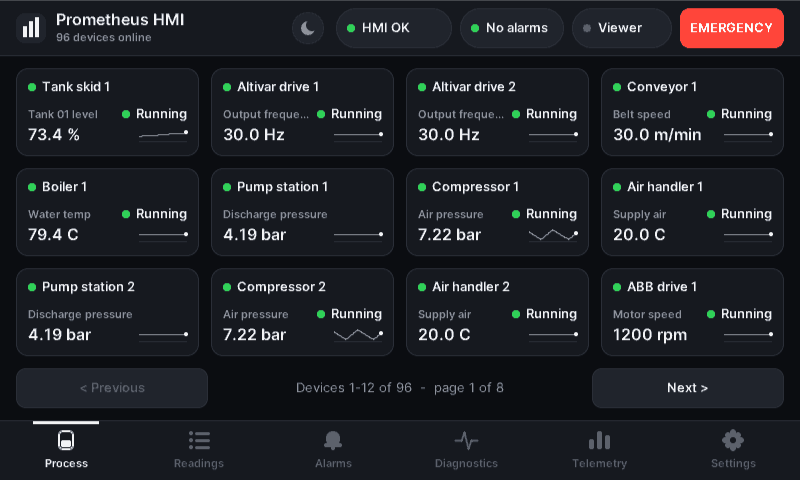
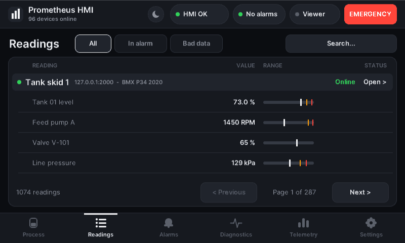
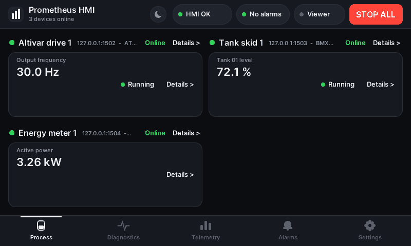
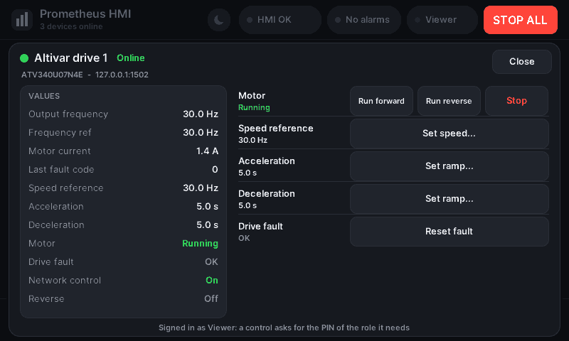
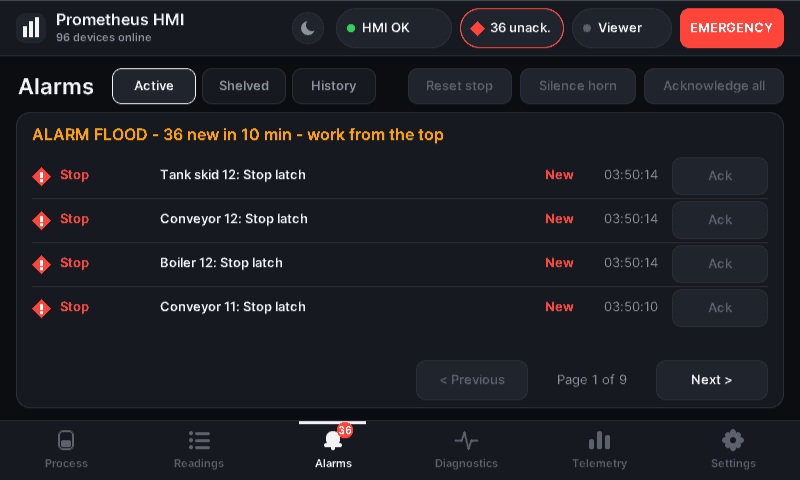
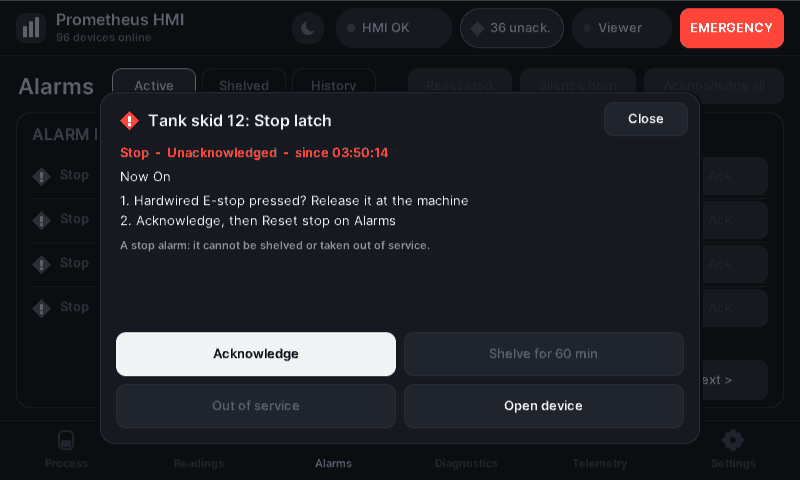
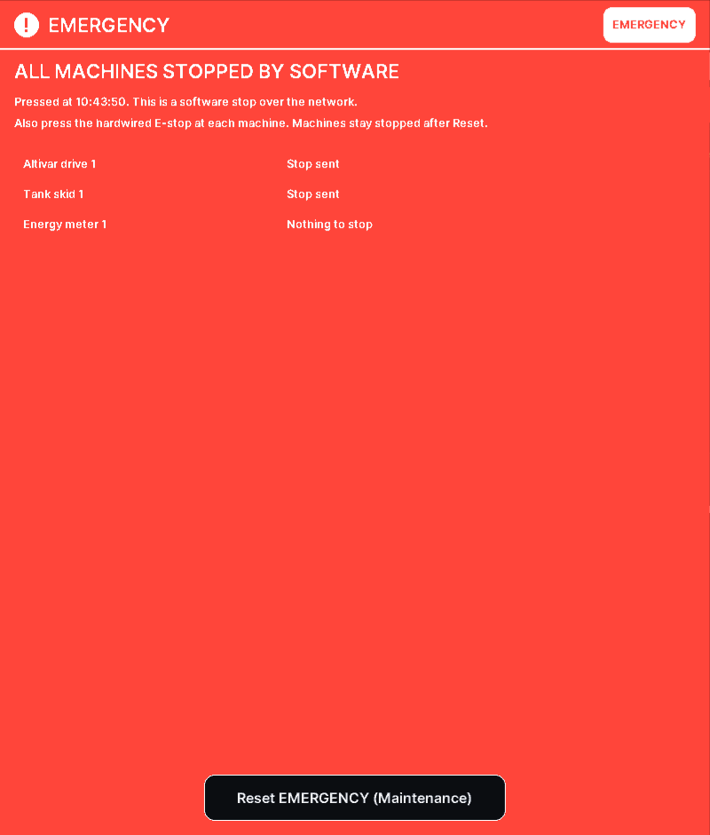
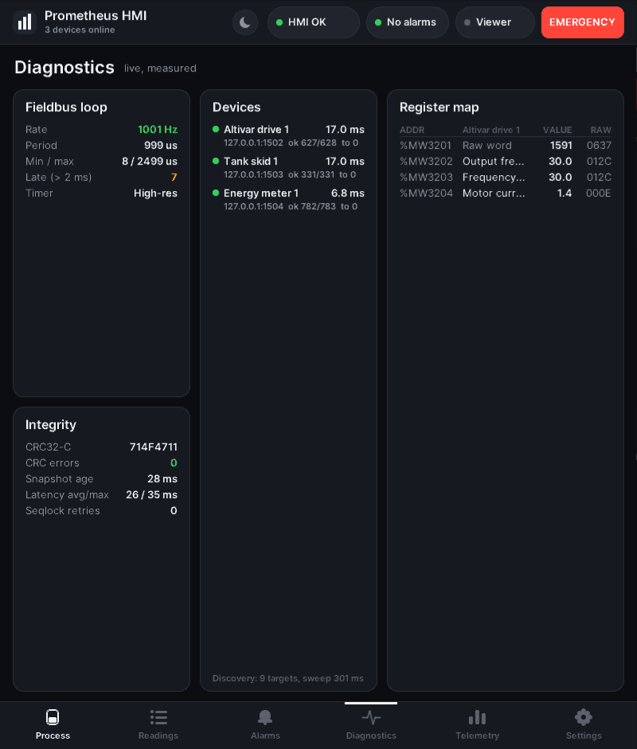

# Prometheus HMI

**An operator panel for PLCs, drives and energy meters over Modbus TCP. Small enough for a
panel PC, built to scale to a whole line.**

Prometheus HMI finds the devices on a control network by itself and shows every live value.
It raises and manages alarms the way ISA-18.2 describes. Operators run the process with
role-based sign-in, and every action goes into a signed audit log. One red button stops
everything. It is written in portable C99 and needs no runtime libraries. It runs on Windows PCs
and panel PCs, Linux desktops and panels, and Raspberry Pi.

<p align="center">
  
</p>

| | |
|---|---|
| **128 devices, 3,104 readings** per HMI | measured live with 96 devices and 1,074 readings |
| **25 ms** average data-to-screen time | target 100 ms; measured, see [benchmarks](docs/benchmarks/README.md) |
| **0.33 ms** to draw a full 800 x 480 screen | in 20 KB of RAM; about 3 times faster than LVGL on the same PC |
| **under 1 MB** of memory in Task Manager | 588 KB with 3 devices, about 940 KB with 48, 1.25 MB with 96 |

All figures were measured on one Windows PC (AMD Ryzen 7 7735HS). Nothing has been measured on
panel hardware yet. See [Status](#status).

---

## Contents

- [What it does](#what-it-does)
- [Screens](#screens)
- [Quick start](#quick-start)
- [Using the panel](#using-the-panel)
- [Supported devices](#supported-devices)
- [Configuration](#configuration)
- [Commissioning a real plant](#commissioning-a-real-plant)
- [Building from source](#building-from-source)
- [Documentation](#documentation)
- [Status](#status)
- [License](#license)

---

## What it does

**Plug and play**
- Finds PLCs and drives by their Modbus identity (FC 43) and attaches the matching driver module.
- Checks the identity again after every reconnect. A different device answering at the same
  address is blocked: it gets no reads and no commands.
- Raises a communication-loss alarm per device, and recovers without operator action.
- Holds up to 128 devices. `--max-devices` sets a lower limit for a site.

**Every value, reachable**
- **Process:** large cards for a few devices, compact tiles for many, each with a 60-second trend
  of its main value. Tap a tile for the **device view**: that device's full graphics (gauges,
  tank, pumps, trend) and its controls. The page buttons count the alarms on other pages, so none
  is hidden.
- **Readings:** every reading of every device in one list. It is grouped by device, can be
  filtered (All, In alarm, Bad data), searched with an on-screen keyboard, and paged.
- **Faceplates:** every value and every control of one device.

**Alarms (ISA-18.2)**
- **States:** new, acknowledged, and cleared but not yet acknowledged.
- **Priorities:** four, each with its own shape and colour.
- **Handling:** per-alarm acknowledge; shelving for 60 minutes (it comes back by itself); out of
  service for maintenance.
- **Floods and chattering:** a flood is detected and announced; chattering alarms are flagged.
  The alarm rate is shown.
- **Guidance:** two steps for the top alarm, the panel's own alarm tone, and an optional wired horn.
- **Sounds:** alarms and EMERGENCY sound different, so nobody confuses them: EMERGENCY loops a
  fast rising siren. On Windows `alarm.mp3` (included) replaces the alarm tone, and an optional
  `emergency.mp3` replaces the siren.

**EMERGENCY**
- One red button, always visible, never blocked by a dialog or by sign-in. Anyone can press it.
- Sends every device its stop, then turns the whole panel red. It lists machine by machine what
  was stopped and what was **not**.
- Stays locked until Maintenance resets it after a confirmation. The reset restarts nothing.

> **EMERGENCY is a software stop, not a certified emergency stop.** It depends on this software,
> the network and each PLC program. Every machine still needs its hardwired E-stop.

**Security (IEC 62443-4-2)**
- **Roles:** Viewer, Operator, Maintenance and Engineer, with least privilege, auto-logout and
  PIN lockout.
- **PINs:** site PINs are required before anything can be operated. They are stored as keyed
  hashes in a signed vault.
- **Audit log:** every command and alarm, chained with HMAC-SHA256. It can be checked offline
  with `--verify-log`.
- **Device key:** kept in a protected system folder that only the HMI account can open.

**Small and fast**
- A purpose-built renderer draws in 19 KB bands, so no full-screen frame buffer is needed.
- A 1 kHz fieldbus loop is separated from the screen by a lock-free hand-off. A watchdog
  supervises both.

## Screens

| | |
|:---:|:---:|
| <br>**Process: 96 devices as tiles** | <br>**Readings: grouped, filtered, searchable** |
| <br>**Process: a few devices as cards** | <br>**Device faceplate** |
| <br>**Alarms, sorted by priority** | <br>**One alarm: acknowledge, shelve, out of service** |
| <br>**EMERGENCY: what stopped, and what did not** | <br>**Diagnostics: loop timing and latency** |

## Quick start

The complete guide is the **[User Manual](docs/USER_MANUAL.md)**.

### Windows

Run `Prometheus-HMI-Setup-<version>.exe` (no administrator rights needed). Or run
`hmi-runtime\industrial_hmi.exe` straight from this folder.

### Linux PC and Raspberry Pi

```sh
tar -xzf prometheus-hmi-linux-x86_64.tar.gz       # or -raspberrypi-arm64 / -raspberrypi-armhf
cd prometheus-hmi-linux-x86_64
./install.sh                                       # per user, no root
```

On a desktop the HMI opens as a window. On a panel without a desktop it draws to the screen
directly. On a server, add `--headless`.

### First sign-in

A new panel has no site PINs, so only the Viewer role can sign in. Set the PINs first (see
[Commissioning](#commissioning-a-real-plant)).

On a test bench, `--config examples\bench.cfg` allows the factory PINs:

| Role | Bench PIN | Can |
|---|---|---|
| Viewer | none | watch; EMERGENCY is always allowed |
| Operator | `1111` | start / stop, setpoints, acknowledge and shelve alarms, reset a stop |
| Maintenance | `2222` | everything above, plus tuning, alarms out of service, watchdog and EMERGENCY reset |
| Engineer | `3333` | everything above, plus raw register writes and fault injection |

## Using the panel

| To | Do |
|---|---|
| See all devices | **Process**; with many devices, use **Next >** (it says how many on other pages are in alarm) |
| Find a value | **Readings**, then **Search...** or a filter |
| Operate a device | tap its tile or card, then the control; the panel asks for the PIN of the role it needs |
| Change a setpoint | tap **Set ...** and type the value (the allowed range is shown) |
| Handle an alarm | read the banner, then tap the alarm on **Alarms** to acknowledge, shelve or open its device |
| Stop everything | **EMERGENCY** (top right) or the `E` key |
| Restart after an EMERGENCY | Maintenance presses **Reset EMERGENCY** and confirms; then release the hardwired E-stop, acknowledge the stop alarm and press **Reset stop**. Nothing restarts by itself |

## Supported devices

Each device type is a driver module in [`hmi-runtime/src/devices/`](hmi-runtime/src/devices/): its
identity, registers, controls, alarm limits and operator guidance, all as constant data.

| Device | Module | Typical controller |
|---|---|---|
| Schneider Altivar ATV340 / ATV630 drive | `altivar_drive.c` | variable speed drive |
| Schneider EM6400NG energy meter | `em6400_meter.c` | power meter (read only) |
| Tank skid | `tank_skid.c` | Modicon M340 |
| Conveyor | `conveyor.c` | Modicon M241 |
| Boiler | `boiler.c` | Modicon M580 |
| Pump station | `pump_station.c` | Siemens S7-1200 |
| Compressor | `compressor.c` | Allen-Bradley Micro850 |
| Air handler | `air_handler.c` | Modicon M251 |
| ABB drive (demonstration map) | `abb_drive.c` | ABB drive |
| Unknown Modbus device | `generic.c` | raw register view and writes |

> Register maps other than the Altivar status and command words are **not verified against real
> hardware**. Each module lists its unverified addresses. Check them against the device's
> documentation before use on a plant.

## Configuration

Options are read from `hmi.cfg` next to the executable (one per line, `#` for comments) and from
the command line. Examples are in [`hmi-runtime/examples/`](hmi-runtime/examples/):
- `starter.cfg`: a new site;
- `lab-site.cfg`: a real network;
- `bench.cfg`: test devices on the same PC.

| Option | Meaning |
|---|---|
| `--scan <range>` | discovery range, e.g. `192.168.1.0/24` or `10.0.0.5:502-510` |
| `--plc <ip[:port][/unit][@module]>` | attach a device explicitly, optionally with its driver module |
| `--max-devices <n>` | attach at most n devices (1 to 128) |
| `--set-pin <role>` | set a role's site PIN (asked twice, never typed on the command line) |
| `--verify-log <path>` | check the audit log's signature chain and exit |
| `--key`, `--vault`, `--log <path>` | other places for the device key, PIN vault and audit log |
| `--color-scheme status\|high-performance` | green normal states (default) or strict ISA-101 grey |
| `--no-sound` | no alarm tone from the speakers (a wired horn is not affected) |
| `--allow-factory-pins` | **bench only**: allow the factory PINs |

The complete list is in [hmi-runtime/README.md](hmi-runtime/README.md#options).

## Commissioning a real plant

1. **Set a site PIN for every role** (6 to 8 digits, no repeated or sequential patterns), as the
   account the HMI runs under, with the HMI closed:

   ```bat
   industrial_hmi.exe --set-pin operator
   industrial_hmi.exe --set-pin maintenance
   industrial_hmi.exe --set-pin engineer
   ```

   Once any site PIN exists, factory PINs and test mode are refused, and every attempt is logged.
2. **List the devices** in `hmi.cfg` (`--scan`, `--plc`). Do not use `--allow-factory-pins`.
3. **Keep the key safe.** The first start creates `hmi.key` in `%ProgramData%\Prometheus HMI`
   (Windows) or `/var/lib/prometheus-hmi` (Linux, as root). Only the HMI account can open that
   folder. The key signs the audit log and the PIN vault. Back it up offline.
4. **Segment the network.** Modbus TCP has no authentication or encryption. Put the HMI and the
   PLCs in their own zone (IEC 62443-3-3).
5. **Add the heartbeat** to each PLC program that should stop when the HMI is lost (see
   [HMI heartbeat](hmi-runtime/README.md#hmi-heartbeat-plc-side)).

The full procedure is in the [Install and Operations Guide](docs/INSTALL-AND-OPERATIONS.md).

## Building from source

| Platform | Toolchain |
|---|---|
| Windows | MinGW-w64 GCC or Microsoft Visual C++ (`cl`) |
| Linux / Raspberry Pi | GCC or Clang, GNU make; `libx11-dev` headers for the desktop window (optional) |
| Raspberry Pi from a PC | `aarch64-linux-gnu-gcc` (64-bit) or `arm-linux-gnueabihf-gcc` (32-bit) |
| Windows installer | NSIS 3 (`makensis`) |

```bat
cd hmi-runtime
build.bat test          REM industrial_hmi.exe and every test suite (Windows)
```

```sh
cd hmi-runtime
make test                                         # every suite, under AddressSanitizer + UBSan
make CC=aarch64-linux-gnu-gcc industrial_hmi      # cross-compile for a 64-bit Raspberry Pi
```

Release packages: `hmi-runtime/installer/build_windows_release.sh` and `build_linux_release.sh`.
Both write SHA-256 checksums.

## Documentation

| Document | For |
|---|---|
| **[User Manual](docs/USER_MANUAL.md)** | operators and supervisors: every screen, alarms, EMERGENCY, troubleshooting |
| [Install and Operations Guide](docs/INSTALL-AND-OPERATIONS.md) | installers and site IT: install, commission, back up, upgrade, run as a service |
| [Architecture](docs/architecture/ARCHITECTURE.md) | engineers: how the runtime works, with diagrams of every part |
| [Where the code starts](docs/code/ENTRY-POINTS.md) | developers: a guided tour of the source |
| [Operator interface design](docs/design/HMI-DESIGN.md) · [Alarm management](docs/design/ALARMS.md) | design rules and the ISA-101 / ISA-18.2 review |
| [Security policy](docs/SECURITY.md) · [Threat model](docs/THREAT-MODEL.md) | security controls, reporting, risks |
| [Standards traceability](docs/STANDARDS.md) | each standard clause, where it is implemented, how it is checked |
| [Design decisions](docs/adr/README.md) | why the main choices were made |
| [Benchmarks](docs/benchmarks/README.md) | what was measured, how, and on what |
| [Known limitations](docs/KNOWN-LIMITATIONS.md) | what is not done, not verified, or not supported |
| [Lab deployment](docs/LAB_DEPLOYMENT.md) | which lab panels can run it |
| [hmi-runtime/README.md](hmi-runtime/README.md) | all options, driver modules, heartbeat, tests |

## Status

| | |
|---|---|
| **Verified** | Test suites, live runs and measurements on Windows, listed in [docs/evidence/](docs/evidence/) and [benchmarks](docs/benchmarks/README.md) |
| **Not run on target hardware** | a Windows panel PC or Harmony P6, a Raspberry Pi touch panel, the ESP32-S3 port (it compiles and runs in Espressif's emulator; never run on a board) |
| **Not verified against real devices** | register maps other than the Altivar status and command words |
| **Not certified** | ISA-101, ISA-18.2, IEC 62443 and ISO 13850 are followed, not certified. This is not a safety system |

Full list: [Known limitations](docs/KNOWN-LIMITATIONS.md).

## License

Prometheus HMI is released under the [MIT License](LICENSE). Copyright (c) 2026 Nikhil Nuguri.
The software is provided "as is", without warranty of any kind.

---

<sub>Prometheus HMI · Nikhil Nuguri · MIT License</sub>
