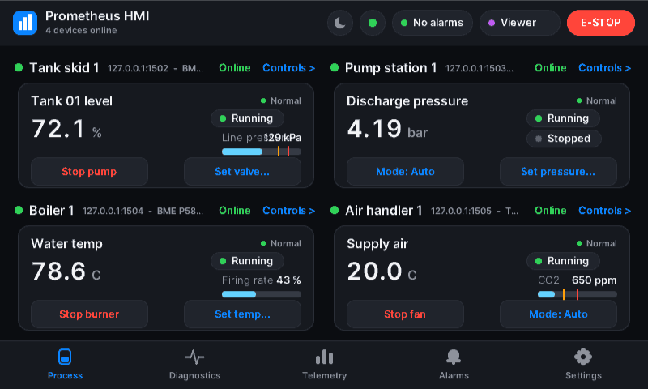
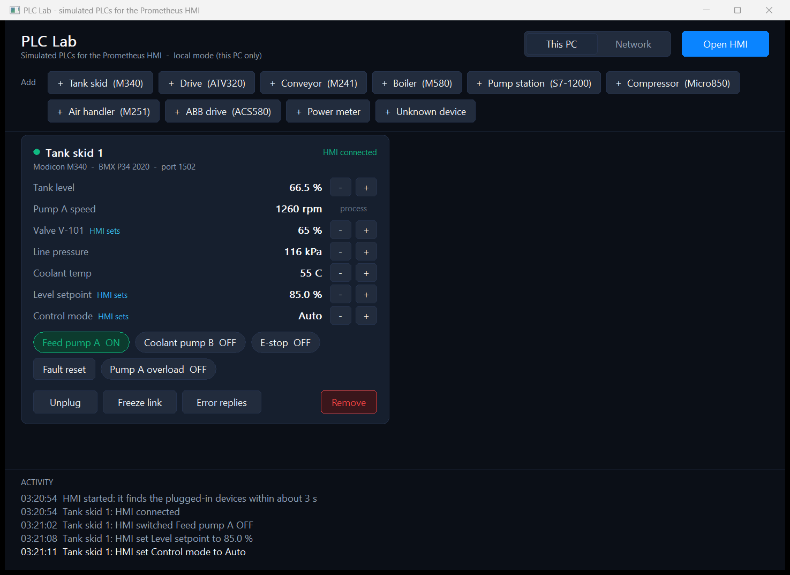
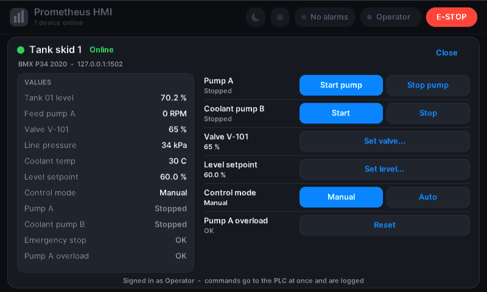
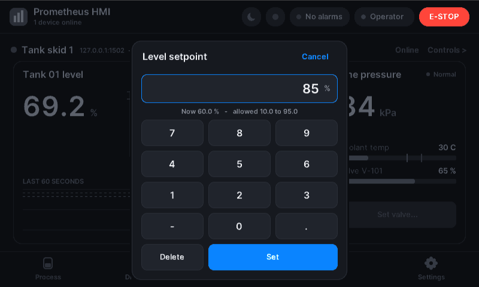
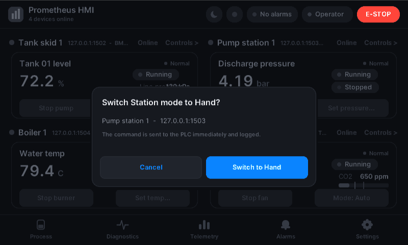
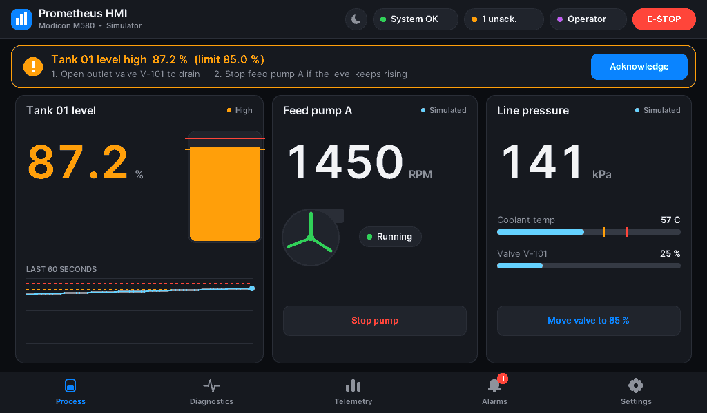
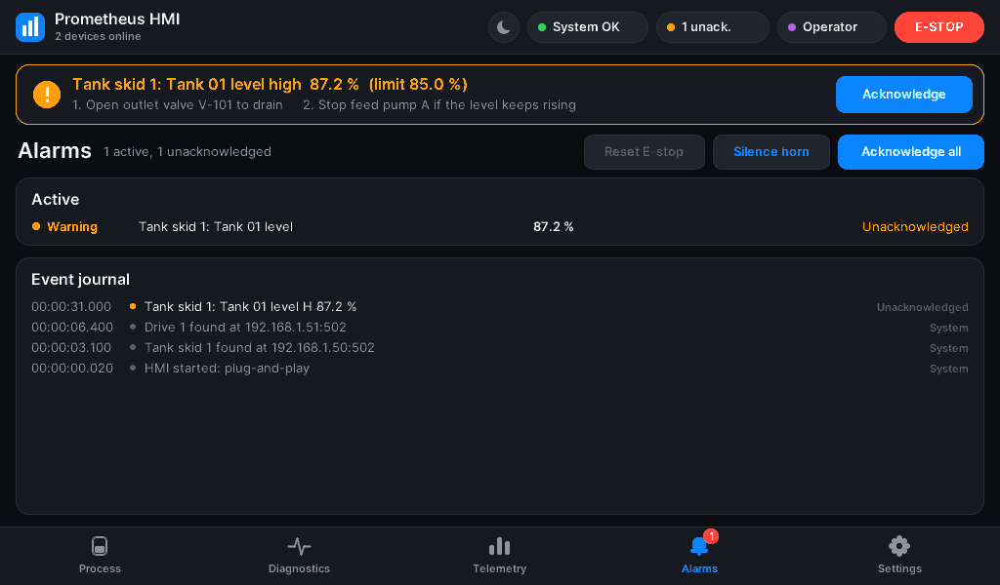

# Prometheus Industrial HMI

A lightweight, **plug-and-play** HMI runtime for PLCs, written in pure C99.
Connect a PLC to the network and it appears on the dashboard with the right
screen. Disconnect it and it goes offline, raises an alarm, then leaves the dashboard.

Two apps:

| App | What it is |
|---|---|
| **`industrial_hmi.exe`** | the HMI runtime: finds PLCs, shows them, raises alarms, and operates them: start / stop, setpoints, modes, resets |
| **`plc_lab.exe`** | a bench of simulated PLCs to test it with: 8 PLC / drive types plus 2 non-PLC devices; add, unplug, change values, break links |

One code base for **Windows**, **Linux / Raspberry Pi** (straight to the framebuffer, no
desktop needed) and **ESP32-S3** microcontrollers. See [Platforms](#platforms) for what is
verified on each.



| | Measured on the dev laptop (Windows 11, `measure.bat`) |
|---|---|
| Executable | **264 KB** with 8 driver modules, statically linked, no DLLs beyond Windows itself |
| RAM | **5.2 MB** working set (including Windows networking), **1.9 MB** private |
| Runtime's own memory | **72 KB** static RAM, **102 KB** code (x86-64); **51 KB** RAM with the MCU profile |
| Frame buffer | one **19,200-byte** band buffer, reused for every band of every frame |
| Heap | no `malloc`/`free` in application code (the C runtime's start-up code imports them) |
| Fieldbus loop | **1,000 Hz**; UI 30 fps; anti-aliased Inter text through a 16-colour palette |
| Detection | a new PLC appears within about 3 s (one FC43 request); non-PLC devices are ignored |
| Tests | 9,294 unit checks (UBSan traps), 8,630 more with the MCU profile, 74 Modbus fault-injection checks, live plug-and-play test, cppcheck clean |

---

## Quick start

```bat
build.bat            :: builds both apps
plc_lab.exe          :: opens the PLC bench (one tank-skid PLC already plugged in)
```

In PLC Lab press **Open HMI**: the HMI starts and the PLC appears on its dashboard within
about 3 s. Then play:

| In PLC Lab | What the HMI does |
|---|---|
| **+ Tank skid, Drive, Conveyor, Boiler, Pump station, Compressor, Air handler, ABB drive** | a new panel appears with that machine's screen; the dashboard splits (up to 4 PLCs) |
| **+ Power meter / + Unknown device** | nothing: it checks them and ignores them (not PLCs). The card says so. |
| **−/+** on a value (level, pressure, temp, demand, CO2…) | the value follows; push it past a limit and the alarm fires |
| click a red input (**E-stop**, **Drive fault**, **Jam**, **Low water**, **Fire alarm**, **Pump 1 fault**…) | the alarm fires, the PLC stops that equipment and refuses a restart until it is reset |
| **Unplug** | *Offline – removing in 10 s*, comm-loss alarm, then the panel leaves. **Plug in** within 10 s and it comes back |
| **Freeze link** | the PLC stops answering: timeout → offline, reconnect attempts |
| **Error replies** | the PLC answers with Modbus exceptions → offline after 3 |
| **Network** (top right) | the PLCs become reachable from other devices, e.g. an HMI on a Raspberry Pi: `--scan <this PC>:1502-1509` |

And from the HMI side, operate the PLCs (see [Operating a PLC](#operating-a-plc)): tap a
device's header for its controls, start and stop, enter setpoints, switch modes, reset
faults, or press **E-STOP**. The lab's activity log shows each command arriving at the PLC.



`industrial_hmi.exe --sim` runs the HMI alone with a built-in simulated tank skid;
`--sim boiler --sim pumps` (types: tank, drive, conveyor, boiler, pumps, compressor, ahu, abb) adds others.
Requirements: MinGW-w64 GCC on `PATH` (MSVC also works from a Developer Prompt).
Linux and Raspberry Pi: `make` (see [Platforms](#platforms)). ESP32: [ports/esp32](ports/esp32/README.md).

> **Smart App Control.** Windows 11's Smart App Control may block a freshly
> compiled, unsigned exe ("An Application Control policy has blocked this file").
> It decides per build, so one build may run and the next may not. The real fix is
> to sign the exe with a trusted code-signing certificate. Managed and embedded
> Windows devices normally have it turned off.

---

## Operating a PLC

Every control works the same way, the way operator panels do it
([ISA-101 style faceplates](https://www.yokogawa.com/us/library/resources/media-publications/isa-101-toward-a-more-effective-hmi-strategy)):

1. **Find it.** The dashboard has quick buttons for the two most used controls of each
   machine (*Stop pump*, *Set speed...*, *Mode: Auto*). Tap the device's header bar
   (**Controls >**) for its **faceplate**: every value on the left, every control on the right.
2. **Who may.** If your role is too low, the control asks for the PIN of the role it needs
   and then carries on (no "access denied" dead end). Viewer watches only.
3. **Interlocks.** A start is refused while its interlock is active (E-stop, trip, jam,
   fire alarm): the button says *Blocked: ...*, and the PLC enforces the same rule.
4. **Values.** Setpoints open a keypad showing the current value and the allowed range;
   out-of-range or malformed entries are refused before anything is sent.
5. **Confirmation.** Mode changes, burner start, counter resets, compressor stop and raw
   register writes ask "Are you sure?" first.
6. **Record.** Every command goes into the hash-chained audit log with who, what and the value.

| Faceplate | Setpoint keypad | Confirmation |
|---|---|---|
|  |  |  |

| Control kind | Button | What is written |
|---|---|---|
| Start / Stop | separate buttons; Start is refused while its interlock is set | coil 1 / 0 |
| Set... | numeric keypad, range-checked | holding register |
| Mode selector | one button per option, the active one highlighted | option index to a register |
| Reset | pulse | coil 1, then 0 after 0.5 s |

---

## Plug and play

```
 network ──► Discovery thread (low priority, every 3 s)
              1. TCP connect to each target (32 at a time, non-blocking)
              2. Modbus FC43 "Read Device Identification" → vendor + product code
              3. a matching driver module that is a PLC/drive?  yes → report it
                                                                 no  → ignore for 60 s
           ──► Fieldbus thread (1 kHz)
              4. attach to a free slot: bind the driver's tags, alarms and screens
              5. poll it (non-blocking Modbus TCP), raise alarms, accept commands
              6. link lost → OFFLINE (critical alarm, keeps reconnecting)
                 back within 10 s → ONLINE again; otherwise removed from the dashboard
           ──► UI thread: the process screen splits itself between the devices
```

* **Only PLCs are attached.** A device found by scanning must identify itself as a model
  that has a driver module (see the table below: Modicon M340 / M580 / M241 / M251,
  Siemens S7-1200, Allen-Bradley Micro850, Altivar and ABB drives). Power meters, gateways
  and anonymous Modbus devices are ignored, probed once, and then left alone for a minute.
* **Explicit addresses.** `--plc 192.168.1.50` watches that address even if the device
  can't identify itself; it gets the generic driver, which shows holding registers 0–7.
* **Where it looks.** By default it checks localhost (ports 502 and 1502–1509, for the
  simulators). Giving `--plc` addresses replaces that default. To scan a plant network, opt in with `--scan 192.168.1.0/24`. Sweeping
  networks uninvited is bad practice on OT networks (IEC 62443), so it is never automatic.
* **Up to 4 devices** at once. The dashboard uses 1 full panel, 2 side by side, or a 2×2 grid,
  and switches each driver to its compact layout when its panel gets small.
* **Removal is not silent.** An unplugged PLC first shows *Offline – removing in N s* and
  raises a critical comm-loss alarm. Its removal is recorded in the alarm log.
  `--remove-after-ms 0` keeps offline devices on screen for good.



### Driver modules: the app stays small

The core runtime knows nothing about any particular PLC. Each supported device type is
one **driver module**: a self-contained file of `const` data (about 70 lines) that
brings everything the HMI needs for that device:

| In the module | Example (Modicon tank skid) |
|---|---|
| Identity match | vendor `schneider`, product `bmx p34\|m340` |
| Tags + alarm limits + operator guidance | Tank 01 level (H 85 %, HH 95 %) … |
| Modbus map | `%MW0..4` → 5 analog tags, `%M0..2` → 3 digital tags |
| Controls | Start / Stop pump A and B (blocked by E-stop), Set valve, Set level, Manual / Auto, Reset overload |
| E-stop | coil `%M2` |
| Screens | a 14-token full layout and a 7-token compact layout (4 bytes per widget) |

Modules live in [src/drivers/profiles/](src/drivers/profiles/). On a microcontroller they
sit in flash and cost no RAM until a device is attached. **Adding a PLC type** means
copying a module, editing its tables, and listing it in `s_profiles[]` in
[src/drivers/device_profiles.c](src/drivers/device_profiles.c). Tests check every module
(tags in range, a comm-loss alarm, every control reachable, both layouts) and check it
against its PLC Lab device: every write address, range, mode option and interlock must
match what the simulated PLC accepts.

Built-in modules (0-based addresses: holding register n = `%MWn` on a Modicon, coil n = `%Mn`):

| Module (identity) | Main values | Operator controls |
|---|---|---|
| **Tank skid** (Modicon M340, `BMX P34`) | level, pump speed, pressure, coolant temp | pump A / B start-stop, valve %, level setpoint, Manual / Auto (PLC holds the level), overload reset, E-stop |
| **Drive** (Altivar ATV320) | output Hz, current, temp, power | start / stop, speed setpoint, Forward / Reverse, acceleration ramp (Maintenance), fault reset |
| **Conveyor** (Modicon M241) | belt speed, item count, throughput, current | start / stop, speed setpoint, jam reset, counter reset, pull-cord E-stop |
| **Boiler** (Modicon M580, `BME P58`) | water temp, firing rate, pressure, drum level | burner light / stop, Manual / Auto (PLC PID), temperature setpoint, manual firing %, low-water trip reset, E-stop |
| **Pump station** (Siemens S7-1200) | discharge pressure, flow, pump speeds, demand | Off / Hand / Auto, pressure setpoint, hand speed, duty pump 1 / 2 (standby takes over on a fault), fault reset |
| **Compressor** (Allen-Bradley Micro850) | air pressure, discharge temp, current | start / stop, load and unload pressure, high-temperature trip reset |
| **Air handler** (Modicon M251) | supply / return air, fan speed, damper, filter, CO2 | fan start / stop, Off / Heat / Cool / Auto, supply setpoint, fan speed setpoint, fire-alarm interlock |
| **ABB drive** (ACS580) | speed, current, torque, DC bus, fault code | start / stop, speed reference, fault reset |
| **Generic** (anything else, only with `--plc`) | holding registers 0-7 | Engineer only: write a register (confirmed) |

The maps are the layouts of the PLC Lab devices (each module's file lists its map).
A site with real PLCs edits the module to its own PLC program's addresses; real drives use
their vendor parameter maps (Altivar RFR 3202 / CMD 8501, ACS580 control and status words).
Siemens and Rockwell controllers often do not answer FC43; add them with `--plc`.

### Try it

Use **PLC Lab** (see [Quick start](#quick-start)). Its devices use exactly these maps and
FC43 identities, so what works there works against a PLC programmed with the same map.
Each lab device is a real Modbus TCP server on ports 1502–1509, the ports the HMI checks
by default.

---

## Using it

The HMI starts as **Viewer**, which can monitor only. Tap the role chip (or press `L`) to sign in.

| Role | Factory PIN | Can do |
|---|---|---|
| Viewer | none | watch; trip the E-STOP |
| Operator | 1111 | acknowledge / silence alarms, start / stop, setpoints, modes, resets, reset E-stop |
| Maintenance | 2222 | + tuning values (drive ramp), reset the watchdog failover latch |
| Engineer | 3333 | + raw register writes on unrecognised devices, watchdog fault-injection test |

Change the factory PINs before real use: `industrial_hmi.exe --set-pin operator 482913`.
Three wrong PINs lock sign-in for 30 s. After 5 minutes without input the HMI drops back to Viewer.

| Action | Touch / mouse | Keyboard |
|---|---|---|
| Switch screen | tab bar, or swipe left/right | `1`–`5`, `Tab`, arrows |
| Emergency stop (all devices that have one) | red **E-STOP** (always on screen, works over dialogs) | `E` |
| Acknowledge / silence | banner button or Alarms screen | `Space`/`A`, `S` |
| Device controls | quick buttons on each panel; **Controls >** opens the faceplate | `O` = faceplate of the first PLC; `P` / `V` = its first / second control |
| Setpoint keypad | digits, `.`, `-`, Delete, Set | digits, `.`, `-`, Backspace, Enter |
| Reset E-stop | Alarms screen (after acknowledging) | `X` |
| Sign in / out | role chip, Settings | `L` |
| Outdoor (light) theme | moon button, Settings | `T` |
| Watchdog test / reset | Settings | `F` / `W` |

Actions fire when you lift your finger, not when you press, so a swipe that starts on a button never operates it.



### Command line

| Option | Meaning |
|---|---|
| `--plc <ip[:port][/uN]>` | watch this PLC address (repeatable); attached even without identification |
| `--scan <range>` | extra discovery targets: `192.168.1.0/24`, `10.0.0.5:502-510`, … (repeatable) |
| `--no-discovery` | no scanning; only `--plc` addresses (and `--sim`) |
| `--sim` | add the built-in simulated tank-skid PLC |
| `--remove-after-ms <n>` | offline devices leave the dashboard after n ms (default 10000, 0 = never) |
| `--log <file>` / `--no-log` | alarm audit log (default `alarms.log` next to the exe) |
| `--vault <file>`, `--set-pin <role> <pin>` | PIN vault location / change a PIN, then exit |
| `--verify-log <file>` | check the log's hash chain; exit 0 = intact, 2 = tampered |
| `--exit-after-ms <n>`, `--report <file>` | timed run with a measured-statistics report (`measure.bat`) |

---

## How it works

```
  Discovery thread ──found PLC──► Fieldbus thread, 1 kHz ─────────► seqlock ──► UI thread, 30 Hz
  (FC43 identification)            device manager: 4 slots,            │         snapshot + CRC check
                                   one Modbus TCP state machine each   │         renderer → band buffer → screen
                                   ISA-18.2 alarms · trends · watchdog │         RBAC · PIN login · gestures
                                   ◄── command bits / audit-event ring ┘         watchdog · hash-chained log
```

* **Nothing blocks the 1 kHz loop.** Discovery runs in its own low-priority thread.
  Every device slot's Modbus client is non-blocking, with one request in flight, a write
  queue, timeouts and reconnect back-off.
* **Two loops that watch each other.** Each thread supervises the other's heartbeat; a
  stall latches a failover alarm (*Settings → Test watchdog* demonstrates it). The process
  opts out of Windows power throttling, so timing holds when the window is in the background.
* **ISA-18.2 alarms** per tag, with device names in the text ("Tank skid 2: Tank 01 level
  HH 96.2 %"). They have deadbands, re-annunciation and E-stop priority, and keep silence
  separate from acknowledge.
* **Audit trail.** Sign-ins, denials, commands, alarms, devices found, offline and removed
  all go to a hash-chained `alarms.log`; `--verify-log` detects edits.
* **Band renderer.** Frames are drawn one band at a time into one 19,200-byte 4-bpp buffer,
  with anti-aliasing through a palette blend table. Inter text is pre-rendered into 26 KB of
  glyphs, so there's no font engine.

### Portability

Everything above runs from one portable core. Only two thin layers differ per target:

```
 src/app.c  + core + renderer + drivers        portable C99, no OS header anywhere
      │  include/app.h          (shell drives the app: input, tick, render)
      │  include/hal/*.h        (app asks the OS: atomics, threads, sockets, files, clock, system)
 ┌────┴──────────────────┬──────────────────────────────┬──────────────────────────────┐
 Windows                  Linux / Raspberry Pi            ESP32-S3 (ESP-IDF)
 platform/win32           platform/linux                  ports/esp32
   window + GDI             /dev/fb0 + evdev touch/keys     RGB panel + GT911 touch
 hal/*_win32.c            hal/*_posix.c  ◄──── same files ────►  hal/*_posix.c
   Winsock, Win32 files     BSD sockets, pthreads,          lwIP sockets, esp_pthread,
                            procfs, clock_nanosleep         LittleFS, FreeRTOS ticks
```

* A platform shell is about 300 lines: open the display, translate input into
  `app_pointer_*()` / `app_key()`, call `app_tick()`, and copy each 4-bpp band to the screen
  through the 16-colour palette (one band = at most 19,200 bytes; no full-frame buffer needed).
* `HMI_PROFILE_MCU` ([include/profile_mcu.h](include/profile_mcu.h)) shrinks the numbers for
  microcontrollers: 2 device slots, 6 parallel discovery sockets, 500 Hz fieldbus loop, 20 fps.
  Any capacity can also be set with `-D` (`HMI_MAX_DEVICES=1..4`, `HMI_DISCOVERY_BATCH`, …).
* Driver modules are compile-time switches: `HMI_DRIVER_TANK_SKID=0`, `HMI_DRIVER_DRIVE=0`
  drop a module (leave its file out of the build too), so a device only carries the drivers it needs.
* `build.bat snapshot` builds [tools/render_snapshot.c](tools/render_snapshot.c), a reference
  port that uses only `<stdio.h>` and renders the dashboard to BMP files.

## Platforms

| Target | Build | Status |
|---|---|---|
| Windows 10/11 | `build.bat` | **verified**: unit, fault-injection and live tests, `measure.bat`, GUI driven with taps, swipes and keys |
| Linux PC, Raspberry Pi | `make` / `make STATIC=1` / `make CC=aarch64-linux-gnu-gcc` | **written, not yet run on Linux**: every Linux source type-checks clean under `-Werror` (checked against glibc/Linux headers on the dev machine); `make test` runs the same unit tests |
| ESP32-S3 + 800×480 RGB panel | `idf.py build` in [ports/esp32](ports/esp32/README.md) | **written, not yet compiled**: targets ESP-IDF 5.3; the core it runs passes all unit tests with the MCU profile |

**Linux / Raspberry Pi.** No X11, Wayland or GUI library: the runtime draws into `/dev/fb0`
(16, 24 or 32 bpp) and reads touch screens, mice and keyboards from `/dev/input/event*`, re-scanned
every 3 s so a USB keyboard or touch panel can be plugged in later. Run it from a text console
(Raspberry Pi OS Lite) as a user in the `video` and `input` groups:

```sh
make && ./industrial_hmi --plc 192.168.1.50
./industrial_hmi --headless --plc 192.168.1.50 --report /tmp/hmi.txt   # no display: alarms + log only
HMI_TOUCH_SWAP_XY=1 HMI_TOUCH_INVERT_Y=1 ./industrial_hmi              # rotated touch panel
```

`--fb /dev/fb1` picks another framebuffer (for example an SPI TFT). `Ctrl+C` / `SIGTERM` shut down
cleanly (log flushed, console restored). With root or `CAP_SYS_NICE` the fieldbus loop runs as
`SCHED_FIFO`; otherwise at normal priority.

**ESP32-S3.** Same runtime, 50.8 KB of static RAM in the MCU profile plus 8 KB + 6 KB thread
stacks; the panel frame buffer sits in PSRAM. Wi-Fi, PLC address and options are set in
`idf.py menuconfig`; the alarm log and PIN vault live on a LittleFS partition. The dashboard
layout is designed for 640×400 and up; small SPI panels (480×320, 320×240) need a compact
layout that is not written yet.

---

## Standards: what is implemented

| Standard | Implemented | Not implemented / limits |
|---|---|---|
| IEC 62443-4-2 | RBAC on every command; PIN auth (salted iterated SHA-256, constant-time); lockout; inactivity logout; audit log; opt-in network scanning; PE hardening | role PINs, not personal accounts; plain Modbus TCP has no TLS; the log chain uses CRC, not a signature |
| ISA-18.2 / IEC 62682 | per-point latching, priorities, deadband, re-annunciation, silence ≠ ack, journal + persistent log | no shelving / suppression |
| ISA-101 | grey-scale graphics, colour only for abnormal states | – |
| IEC 61508 (design practices only) | no dynamic memory; bounded loops; cross-supervising watchdogs; snapshot CRC | **not certified**. The HMI E-STOP is a *request*: plants still need a hardwired, certified E-stop |

---

## Tests

```bat
build.bat test           :: 9,294 unit checks + MCU-profile run + 74 Modbus fault-injection checks
python tests\ui_modal_stall_test.py   :: window drag / system menu must not trip the watchdog
:: headless plug-and-play test against real sockets:
start python tests\modbus_plc_sim.py --profile tank  --port 1502 --outage-at 7 --outage-for 3 --run-for 24
start python tests\modbus_plc_sim.py --profile meter --port 1504 --run-for 24
tests\test_modbus_live.exe 18
```

The unit tests cover:
* CRC32-C and SHA-256 test vectors
* tags and the per-device trends
* every ISA-18.2 transition
* RBAC, PIN and vault
* the Modbus and FC43 codecs, including 20,000 random frames
* driver-module matching for all 8 PLC identities; a power meter is rejected
* every driver module against its PLC Lab device: write addresses, setpoint ranges, mode options,
  pulse coils and interlocks must agree with what the simulated PLC accepts
* the device manager: attach, unique labels, Start / Stop, setpoints in and out of range, mode
  selectors, pulses, E-stop interlock, PLC-only policy, every simulated device type online
* dashboard layout for 1–4 devices at six screen sizes, every button hit-tested; every faceplate
  control, keypad key and confirmation button of every module hit-tested at every size
* rendering at 13 sizes with buffer guard bytes, including faceplate, keypad and confirmation
* alarm-log tamper detection
* the portable layer: IPv4 parsing, file append / replace / handle pool, UTC stamps, random bytes, atomics
* PLC Lab's 10 device models, driven by the HMI's own Modbus codec: reads, writes, range refusals,
  interlocks, resets, identities, fault modes, and each process (tank auto level, drive ramps and
  reversing, conveyor counting and jams, boiler PID and low-water trip, pump-station standby
  takeover, compressor load / unload band and temperature trip, air-handler setpoint and fire alarm)

The live test confirms:
* the tank PLC is found and attached with the right driver
* the meter is ignored
* a valve command reaches the PLC
* the outage is detected and the PLC recovers by itself

## Layout

```
build.bat · measure.bat                 Windows
lab/                         PLC Lab window (plc_lab_win32.c); its device models + Modbus server are src/drivers/plc_sim.c (also used by --sim)
Makefile                                Linux / Raspberry Pi
src/app.c                    the application: threads, input, frames, CLI (portable)
src/platform/win32, linux    platform shells (window / framebuffer, input, entry point)
ports/esp32/                 ESP-IDF project (shell, board pins, partitions)
src/hal/                     atomics, threads, sockets, files, clock, system: *_win32.c / *_posix.c
src/drivers/profiles/        driver modules (one per PLC / drive type)
src/drivers/                 device_manager, discovery, modbus_proto, device_profiles (registry)
src/core, src/renderer       tags, alarms, log, security / band renderer, layout, fonts
tests/                       test_core.c, test_modbus_faults.c, test_modbus_live.c, modbus_plc_sim.py
tools/                       bake_fonts.py, render_snapshot.c
fonts/OFL.txt · docs/img/
```
