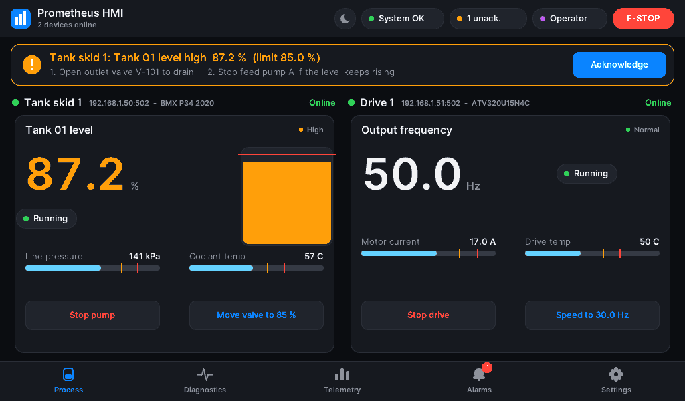

# Prometheus Industrial HMI

A lightweight, **plug-and-play** HMI runtime for PLCs, written in pure C99.
Connect a PLC to the network and it appears on the dashboard with the right
screen. Disconnect it and it goes offline, raises an alarm, then leaves the dashboard.



| | Measured on the dev laptop (Windows 11, `measure.bat`) |
|---|---|
| Executable | **212 KB**, statically linked, no DLLs beyond Windows itself |
| RAM | **5.6 MB** working set (including Windows networking), **1.9 MB** private |
| Frame buffer | one **19,200-byte** band buffer, reused for every band of every frame |
| Heap | no `malloc`/`free` in application code (the C runtime's start-up code imports them) |
| Fieldbus loop | **1,000 Hz**, worst period about 2.4 ms |
| UI | 30 fps; anti-aliased Inter text through a 16-colour palette |
| Detection | a new PLC appears within about 3 s (one FC43 request); non-PLC devices are ignored |
| Tests | 4,371 unit checks (UBSan traps), live plug-and-play test, cppcheck clean, `-Werror` clean at -O0…-O3 |

---

## Quick start

```bat
build.bat test       :: build industrial_hmi.exe and run the unit tests
demo.bat             :: plug-and-play demo: plug in PLCs one by one (needs Python 3)
industrial_hmi.exe   :: start empty and search for PLCs
industrial_hmi.exe --sim   :: no hardware and no Python: built-in simulated tank-skid PLC
```

Requirements: MinGW-w64 GCC on `PATH` (MSVC also works from a Developer Prompt).

> **Smart App Control.** Windows 11's Smart App Control may block a freshly
> compiled, unsigned exe ("An Application Control policy has blocked this file").
> It decides per build, so one build may run and the next may not. The real fix is
> to sign the exe with a trusted code-signing certificate. Managed and embedded
> Windows devices normally have it turned off.

---

## Plug and play

```
 network ──► Discovery thread (low priority, every 3 s)
              1. TCP connect to each target (32 at a time, non-blocking)
              2. Modbus FC43 "Read Device Identification" → vendor + product code
              3. a matching driver module that is a PLC/drive?  yes → report it
                                                                 no  → ignore for 60 s
           ──► Fieldbus thread (1 kHz)
              4. attach to a free slot: bind the driver's tags, alarms and screens
              5. poll it (non-blocking Modbus TCP), raise alarms, accept commands
              6. link lost → OFFLINE (critical alarm, keeps reconnecting)
                 back within 10 s → ONLINE again; otherwise removed from the dashboard
           ──► UI thread: the process screen splits itself between the devices
```

* **Only PLCs are attached.** A device found by scanning must identify itself as a model
  that has a driver module. Today that means Modicon M340/M580 CPUs (`BMX…`, `BME…`) and
  Altivar drives (`ATV…`). Power meters, gateways and anonymous Modbus devices are
  ignored, probed once, and then left alone for a minute.
* **Explicit addresses.** `--plc 192.168.1.50` watches that address even if the device
  can't identify itself; it gets the generic driver, which shows holding registers 0–7.
* **Where it looks.** By default it checks localhost (ports 502 and 1502–1509, for the
  simulators). Giving `--plc` addresses replaces that default. To scan a plant network, opt in with `--scan 192.168.1.0/24`. Sweeping
  networks uninvited is bad practice on OT networks (IEC 62443), so it is never automatic.
* **Up to 4 devices** at once. The dashboard uses 1 full panel, 2 side by side, or a 2×2 grid,
  and switches each driver to its compact layout when its panel gets small.
* **Removal is not silent.** An unplugged PLC first shows *Offline – removing in N s* and
  raises a critical comm-loss alarm. Its removal is recorded in the alarm log.
  `--remove-after-ms 0` keeps offline devices on screen for good.


### Driver modules: the app stays small

The core runtime knows nothing about any particular PLC. Each supported device type is
one **driver module**: a self-contained file of `const` data (about 70 lines) that
brings everything the HMI needs for that device:

| In the module | Example (Modicon tank skid) |
|---|---|
| Identity match | vendor `schneider`, product `bmx\|bme\|m340\|m580` |
| Tags + alarm limits + operator guidance | Tank 01 level (H 85 %, HH 95 %) … |
| Modbus map | `%MW0..4` → 5 analog tags, `%M0..2` → 3 digital tags |
| Buttons | toggle coil `%M0` "Start/Stop pump" (blocked while E-stop is active) … |
| E-stop | coil `%M2` |
| Screens | a 14-token full layout and an 8-token compact layout (4 bytes per widget) |

Modules live in [src/drivers/profiles/](src/drivers/profiles/). On a microcontroller they
sit in flash and cost no RAM until a device is attached. **Adding a PLC type** means
copying a module, editing its tables, and listing it in `s_profiles[]` in
[src/drivers/device_profiles.c](src/drivers/device_profiles.c). Tests check every module
(tags in range, a comm-loss alarm, labels, both layouts).

Built-in modules and their Modbus maps (0-based addresses; on an M340/M580 `%MWn` = holding register n, `%Mn` = coil n):

| Module | Registers (FC03) | Coils (FC01) | Writes |
|---|---|---|---|
| Tank skid (M340/M580) | 0 level 0.1 %, 1 pump RPM, 2 valve %, 3 pressure kPa, 4 coolant °C | 0 pump A, 1 coolant pump B, 2 E-stop | `%M0` pump, `%M2` E-stop, `%MW2` valve |
| Drive (ATV) | 0 output 0.1 Hz, 1 current 0.1 A, 2 speed setpoint 0.1 Hz, 3 drive °C | 0 run, 1 fault | `%M0` run, `%MW2` setpoint |
| Generic | HR 0–7 shown as values | – | none |

The drive module uses the register layout of the bundled simulator. A real Altivar uses
its own addresses (RFR 3202, LCR 3204, CMD 8501…), so a production drive module would
carry those.

### Try it

```bat
python tests\modbus_plc_sim.py --profile tank  --port 1502   :: Modicon M340 tank skid
python tests\modbus_plc_sim.py --profile drive --port 1503   :: Altivar ATV320
python tests\modbus_plc_sim.py --profile meter --port 1504   :: PM5560 power meter: ignored
python tests\modbus_plc_sim.py --profile anon  --port 1505   :: no FC43: ignored
```

Start the HMI, then start or stop these in any order and watch the dashboard follow.

---

## Using it

The HMI starts as **Viewer**, which can monitor only. Tap the role chip (or press `L`) to sign in.

| Role | Factory PIN | Can do |
|---|---|---|
| Viewer | none | watch; trip the E-STOP |
| Operator | 1111 | acknowledge / silence alarms, start/stop equipment, setpoints, reset E-stop |
| Maintenance | 2222 | + reset the watchdog failover latch |
| Engineer | 3333 | + watchdog fault-injection test |

Change the factory PINs before real use: `industrial_hmi.exe --set-pin operator 482913`.
Three wrong PINs lock sign-in for 30 s. After 5 minutes without input the HMI drops back to Viewer.

| Action | Touch / mouse | Keyboard |
|---|---|---|
| Switch screen | tab bar, or swipe left/right | `1`–`5`, `Tab`, arrows |
| Emergency stop (all devices that have one) | red **E-STOP** (always on screen, works over dialogs) | `E` |
| Acknowledge / silence | banner button or Alarms screen | `Space`/`A`, `S` |
| Device buttons | on each device panel | `P` / `V` = first / second button of the first PLC |
| Reset E-stop | Alarms screen (after acknowledging) | `X` |
| Sign in / out | role chip, Settings | `L` |
| Outdoor (light) theme | moon button, Settings | `T` |
| Watchdog test / reset | Settings | `F` / `W` |

Actions fire when you lift your finger, not when you press, so a swipe that starts on a button never operates it.


### Command line

| Option | Meaning |
|---|---|
| `--plc <ip[:port][/uN]>` | watch this PLC address (repeatable); attached even without identification |
| `--scan <range>` | extra discovery targets: `192.168.1.0/24`, `10.0.0.5:502-510`, … (repeatable) |
| `--no-discovery` | no scanning; only `--plc` addresses (and `--sim`) |
| `--sim` | add the built-in simulated tank-skid PLC |
| `--remove-after-ms <n>` | offline devices leave the dashboard after n ms (default 10000, 0 = never) |
| `--log <file>` / `--no-log` | alarm audit log (default `alarms.log` next to the exe) |
| `--vault <file>`, `--set-pin <role> <pin>` | PIN vault location / change a PIN, then exit |
| `--verify-log <file>` | check the log's hash chain; exit 0 = intact, 2 = tampered |
| `--exit-after-ms <n>`, `--report <file>` | timed run with a measured-statistics report (`measure.bat`) |

---

## How it works

```
  Discovery thread ──found PLC──► Fieldbus thread, 1 kHz ─────────► seqlock ──► UI thread, 30 Hz
  (FC43 identification)            device manager: 4 slots,            │         snapshot + CRC check
                                   one Modbus TCP state machine each   │         renderer → band buffer → screen
                                   ISA-18.2 alarms · trends · watchdog │         RBAC · PIN login · gestures
                                   ◄── command bits / audit-event ring ┘         watchdog · hash-chained log
```

* **Nothing blocks the 1 kHz loop.** Discovery runs in its own low-priority thread.
  Every device slot's Modbus client is non-blocking, with one request in flight, a write
  queue, timeouts and reconnect back-off.
* **Two loops that watch each other.** Each thread supervises the other's heartbeat; a
  stall latches a failover alarm (*Settings → Test watchdog* demonstrates it). The process
  opts out of Windows power throttling, so timing holds when the window is in the background.
* **ISA-18.2 alarms** per tag, with device names in the text ("Tank skid 2: Tank 01 level
  HH 96.2 %"). They have deadbands, re-annunciation and E-stop priority, and keep silence
  separate from acknowledge.
* **Audit trail.** Sign-ins, denials, commands, alarms, devices found, offline and removed
  all go to a hash-chained `alarms.log`; `--verify-log` detects edits.
* **Band renderer.** Frames are drawn one band at a time into one 19,200-byte 4-bpp buffer,
  with anti-aliasing through a palette blend table. Inter text is pre-rendered into 26 KB of
  glyphs, so there's no font engine.

### Portability

| Portable C99 (no OS headers) | Windows platform layer |
|---|---|
| core: tags, alarms, security, sha256, crc32, watchdog | `main.c`, `hal/display_win32.c`, `hal/timer.c` |
| renderer: layout, micro_renderer, fonts | `drivers/device_manager.c`, `drivers/discovery.c` (sockets) |
| drivers: modbus_proto, **all driver modules** | `drivers/driver_host.c`, `core/alarm_log.c` (files) |

`build.bat snapshot` builds [tools/render_snapshot.c](tools/render_snapshot.c), a port that
uses only `<stdio.h>` and renders the multi-PLC dashboard to BMP files (the screenshots here
come from it). A Linux framebuffer or microcontroller port needs: a sink for each 4-bpp band, a
millisecond clock and 1 kHz task, touch events, and BSD sockets (the device manager and
discovery use the WinSock subset of the BSD API). Those back-ends aren't written yet.

---

## Standards: what is implemented

| Standard | Implemented | Not implemented / limits |
|---|---|---|
| IEC 62443-4-2 | RBAC on every command; PIN auth (salted iterated SHA-256, constant-time); lockout; inactivity logout; audit log; opt-in network scanning; PE hardening | role PINs, not personal accounts; plain Modbus TCP has no TLS; the log chain uses CRC, not a signature |
| ISA-18.2 / IEC 62682 | per-point latching, priorities, deadband, re-annunciation, silence ≠ ack, journal + persistent log | no shelving / suppression |
| ISA-101 | grey-scale graphics, colour only for abnormal states | – |
| IEC 61508 (design practices only) | no dynamic memory; bounded loops; cross-supervising watchdogs; snapshot CRC | **not certified**. The HMI E-STOP is a *request*: plants still need a hardwired, certified E-stop |

---

## Tests

```bat
build.bat test           :: 4,371 unit checks with UBSan traps
:: headless plug-and-play test against real sockets:
start python tests\modbus_plc_sim.py --profile tank  --port 1502 --outage-at 7 --outage-for 3 --run-for 24
start python tests\modbus_plc_sim.py --profile meter --port 1504 --run-for 24
tests\test_modbus_live.exe 18
```

The unit tests cover:
* CRC32-C and SHA-256 test vectors
* tags and the per-device trends
* every ISA-18.2 transition
* RBAC, PIN and vault
* the Modbus and FC43 codecs, including 20,000 random frames
* driver-module matching: a power meter is rejected
* the device manager: attach, unique labels, actions, E-stop interlock, PLC-only policy
* dashboard layout for 1–4 devices at six screen sizes, every button hit-tested
* rendering at 13 sizes with buffer guard bytes
* alarm-log tamper detection

The live test confirms:
* the tank PLC is found and attached with the right driver
* the meter is ignored
* a valve command reaches the PLC
* the outage is detected and the PLC recovers by itself

## Layout

```
build.bat · measure.bat · demo.bat
src/drivers/profiles/        driver modules (one per PLC / drive type)
src/drivers/                 device_manager, discovery, modbus_proto, device_profiles (registry)
src/core, src/renderer, src/hal, src/main.c
tests/                       test_core.c, test_modbus_live.c, modbus_plc_sim.py
tools/                       bake_fonts.py, render_snapshot.c
fonts/OFL.txt · docs/img/
```
