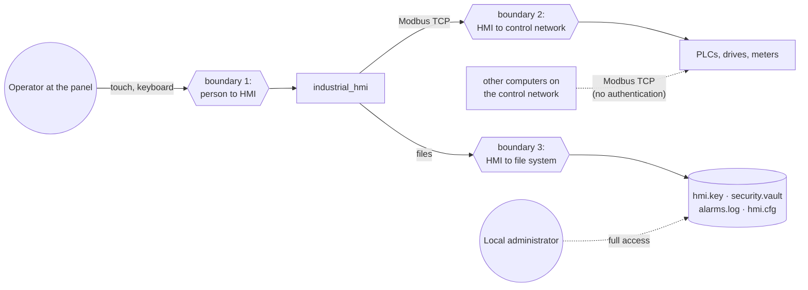

# Threat Model

What could go wrong, on purpose or by accident, and what stops it. The controls are listed
in the [Security policy](SECURITY.md). Method: assets, trust boundaries, then threats grouped
by STRIDE (spoofing, tampering, repudiation, information disclosure, denial of service,
elevation of privilege).

---

## 1. Assets

| Asset | Why it matters |
|---|---|
| The machines | Wrong commands can start, stop or overdrive equipment |
| The ability to stop | EMERGENCY must work at any moment |
| What the operator sees | A wrong or stale value leads to a wrong decision |
| Role PINs | They decide who may operate |
| Device key (`hmi.key`) | It signs the audit log and the PIN vault |
| Audit log (`alarms.log`) | The record of who did what, for investigations |

## 2. Trust boundaries

| Boundary | Trusted side | Untrusted side |
|---|---|---|
| 1. Person to HMI | the HMI | whoever stands at the panel |
| 2. HMI to network | the HMI | every device and computer on the control network |
| 3. HMI to file system | the HMI's account and the operating system | other local accounts |

**Out of scope:** a local administrator, and anyone with physical access to the disk. They can
replace the program or read the key. The site's own physical and IT controls cover that.

## 3. Threats and controls

| # | STRIDE | Threat | Control in the HMI | Residual risk |
|---|---|---|---|---|
| T1 | Spoofing | Someone at the panel acts as Operator without the PIN | Roles; PIN on demand; lockout after 3 failures (30 s); auto-logout after 5 min | PINs are shared per role, not per person; anyone who can run programs as the HMI's account can set new PINs with `--set-pin` |
| T2 | Spoofing | Factory PINs used on a real plant | Factory PINs only with `--allow-factory-pins`, and never once a site PIN exists; refused attempts logged | none known |
| T3 | Spoofing | A different or rogue device answers at a PLC's address (swap, IP conflict) | FC43 identity re-checked after every connect; nothing read or written until it matches; blocked and alarmed | A device that copies another's identity is not detected (Modbus has no device authentication) |
| T4 | Tampering | Another computer writes to a PLC directly over Modbus | None possible in the HMI | **High unless the network is segmented** (site control: IEC 62443-3-3 zones) |
| T5 | Tampering | Malformed or hostile Modbus replies crash the HMI or corrupt memory | Strict frame checks; bounded buffers; no heap; fault-injection tests | Bugs not found by tests |
| T6 | Tampering | Audit records edited, reordered or deleted | HMAC-SHA256 chain under a per-device key; `--verify-log` | Records cut off the end of the newest file are not detected without an outside copy |
| T7 | Tampering | PIN vault replaced with one holding known PINs | The vault is signed with a key derived from `hmi.key`; an unsigned or altered vault is refused | An attacker who can read `hmi.key` can sign a vault (needs the HMI account or an administrator) |
| T8 | Repudiation | An operator denies having issued a command | Every command, sign-in, refusal, shelve, EMERGENCY and reset is logged with its role | Logged per role, not per person |
| T9 | Information disclosure | PINs read from shell history or process lists | PINs are never accepted on the command line; asked on the console | none known |
| T10 | Information disclosure | `hmi.key` read by another local account, also by creating the protected folder before the HMI does | Protected folder: SYSTEM, Administrators and the HMI account only (Windows DACL); mode 0700 (Linux); a folder owned by another account is refused, and an existing one is protected again on every start | Administrators can read it |
| T11 | Information disclosure | Process values read off the network | None (Modbus TCP is plain text) | Network segmentation |
| T12 | Denial of service | The HMI freezes, so nobody can stop the plant from it | UI and fieldbus watchdogs; the HMI heartbeat stops, so PLCs that watch it go to their safe state; hardwired E-stop | Machines whose PLC program does not watch the heartbeat keep running |
| T13 | Denial of service | An alarm flood hides the important alarm | Sorted by priority; flood detected and announced; Info alarms silent during a flood; shelving | The operator must still work through the list |
| T14 | Denial of service | Too many devices on the network | `--max-devices`; devices beyond the limit are named, raised as "Devices not shown", and reported by EMERGENCY as not stopped | none known |
| T15 | Denial of service | A command blocked by a dialog or sign-in during an emergency | EMERGENCY needs no role and is never covered by a dialog | It is a software stop: it depends on the network and each PLC |
| T16 | Elevation of privilege | A Viewer triggers an Operator action through a code path that skips the role check | Every command goes through `hmi_security_authorize()`; refusals are logged | Bugs not found by review or tests |
| T17 | Elevation of privilege | A second HMI instance on the same files breaks the log chain or the vault | Single-instance lock next to the key; `--set-pin` refuses while the HMI runs | none known |

## 4. Review

This model was written for Build-19 by the project team. It has not been reviewed by an
independent assessor. Review it again when:
- a new protocol or interface is added;
- the security controls change;
- the HMI runs on a new platform.
