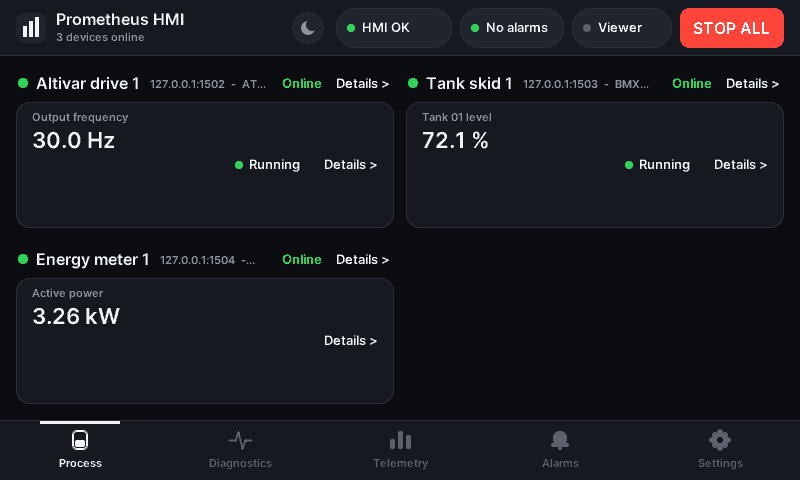
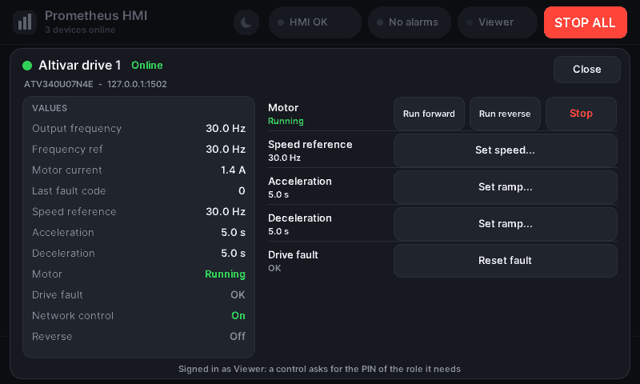
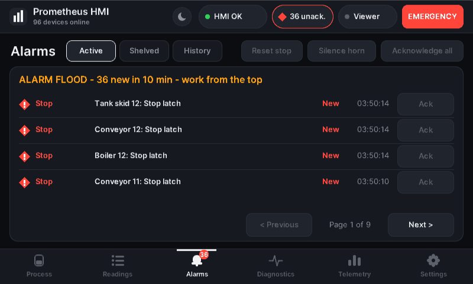
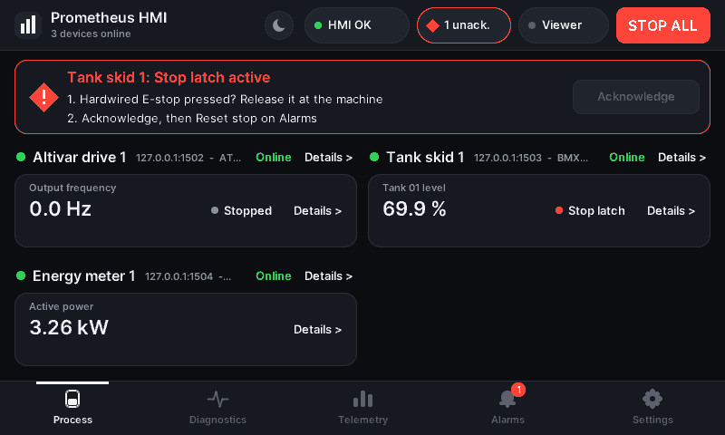
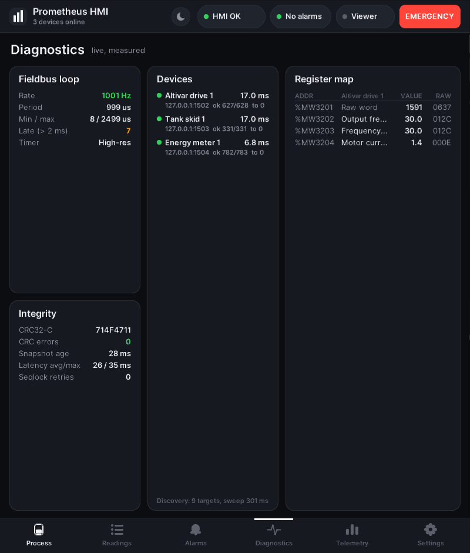
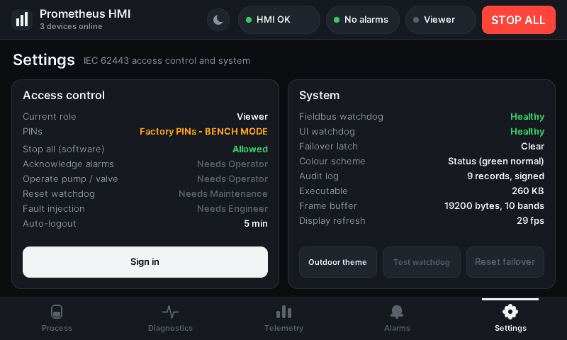
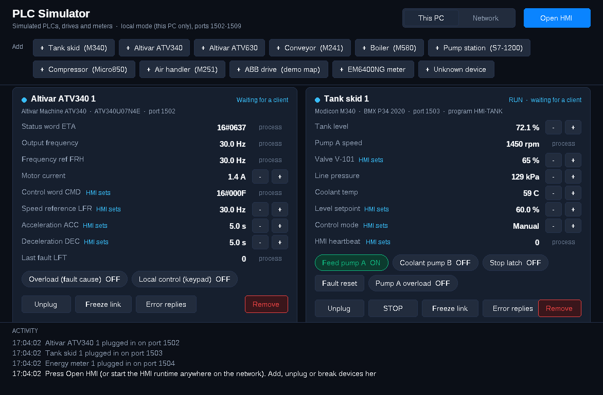

# Prometheus HMI — User Manual

Operator panel and PLC simulator for machines controlled over Modbus TCP.

---

## Contents

1. [Introduction](#1-introduction)
2. [Safety information](#2-safety-information)
3. [System requirements](#3-system-requirements)
4. [Installation](#4-installation)
5. [Starting the HMI](#5-starting-the-hmi)
6. [The screen at a glance](#6-the-screen-at-a-glance)
7. [Signing in and user roles](#7-signing-in-and-user-roles)
8. [Process screen](#8-process-screen)
9. [Operating a device](#9-operating-a-device)
10. [Alarms](#10-alarms)
11. [STOP ALL and restarting after a stop](#11-stop-all-and-restarting-after-a-stop)
12. [Diagnostics screen](#12-diagnostics-screen)
13. [Telemetry screen](#13-telemetry-screen)
14. [Settings screen](#14-settings-screen)
15. [Keyboard shortcuts](#15-keyboard-shortcuts)
16. [The PLC simulator](#16-the-plc-simulator)
17. [Configuration](#17-configuration)
18. [Commissioning a plant](#18-commissioning-a-plant)
19. [Audit log](#19-audit-log)
20. [Files and folders](#20-files-and-folders)
21. [Troubleshooting](#21-troubleshooting)
22. [Glossary](#22-glossary)

---

## 1. Introduction

Prometheus HMI is a human–machine interface (HMI): the screen an operator uses to watch and run a
machine or a process. It connects to PLCs, variable speed drives and energy meters over Modbus
TCP, finds them on the network by itself, and gives each one a screen with its live values and
controls.

The package contains two programs:

| Program | File | What it does |
|---|---|---|
| **HMI runtime** | `industrial_hmi.exe` (Windows), `industrial_hmi` (Linux) | The operator panel. |
| **PLC simulator** | `plc_simulator.exe` (window), `plc_simulator_cli` (console) | Simulated PLCs, drives and meters for training and testing without a real plant. |

**Who this manual is for**

- **Operators** — sections 5 to 15.
- **Engineers and administrators** — all sections, in particular 17 to 21.

## 2. Safety information

> **STOP ALL is not an emergency stop.**
> STOP ALL sends stop requests to the machines over the network. It depends on this software, the
> PC, the network and the PLC program. Every machine must have its own hardwired emergency stop
> as required by ISO 13850 and IEC 60204-1. In an emergency, use the hardwired emergency stop
> first.

- This software is **not a safety system** and is not certified to IEC 61508, IEC 62061 or
  ISO 13849. Safety functions belong in the machine's safety circuits and safety PLC.
- Only trained persons may operate machines from the HMI. Every command is recorded with the role
  that sent it.
- Device register maps supplied for products other than the Altivar status and command words have
  not been verified against real hardware. An engineer must check each map against the device
  documentation before the HMI is used on a real machine.
- Modbus TCP has no built-in security. Keep the HMI and the controllers on a separate, protected
  control network.

## 3. System requirements

| Item | Minimum |
|---|---|
| **Windows** | Windows 10 or 11 (64-bit), including Windows 10 IoT panel PCs |
| **Linux** | any 64-bit x86 distribution; desktop (X11 or Wayland with XWayland), framebuffer panel, or headless server |
| **Raspberry Pi** | Pi 3, 4 or 5 (64-bit OS) or Pi Zero 2 / 2 / 3 (32-bit OS) |
| **Display** | 800 × 480 recommended (7-inch panel); 640 × 400 minimum |
| **Memory** | under 1 MB for the HMI itself |
| **Disk** | under 1 MB for the programs, plus space for the alarm log |
| **Input** | touch screen, mouse or keyboard |
| **Sound** | speakers or headset for the alarm tone (optional) |
| **Network** | Ethernet or Wi-Fi to the controllers (Modbus TCP, port 502 or the device's port) |

No other software, runtime or framework is needed.

## 4. Installation

### 4.1 Windows — run from the folder (no installation)

1. Download the project folder (or the portable ZIP) and unpack it anywhere.
2. Double-click **`plc-simulator\plc_simulator.exe`** to start the simulator.
3. Press **Open HMI** in the simulator window.

To run the HMI on its own, use `hmi-runtime\industrial_hmi.exe`.

### 4.2 Windows — installer

1. Run **`Prometheus-HMI-Setup-<version>.exe`**.
2. If Windows shows *"Windows protected your PC"*, choose **More info → Run anyway**.
3. Follow the installer. No administrator rights are needed; the programs are installed for the
   current user in `%LOCALAPPDATA%\Programs\Prometheus HMI`.

The installer creates:

| Shortcut | Starts |
|---|---|
| **Prometheus HMI** (desktop) | the simulator with a drive, a tank and a meter, then the HMI |
| Start menu → **Prometheus HMI (bench with simulator)** | the same |
| Start menu → **Prometheus HMI** | the HMI alone (reads `hmi.cfg` in the install folder) |
| Start menu → **PLC Simulator** | the simulator alone |
| Start menu → **Uninstall Prometheus HMI** | removes the programs |

Uninstalling keeps the alarm log, the device key and the PIN vault.

### 4.3 Linux PC and Raspberry Pi

```sh
tar -xzf prometheus-hmi-linux-x86_64.tar.gz      # Raspberry Pi: -raspberrypi-arm64 or -raspberrypi-armhf
cd prometheus-hmi-linux-x86_64
./install.sh
```

The installer needs no root rights. It puts the programs in `~/.local/lib/prometheus-hmi`, adds
the commands `prometheus-hmi` and `prometheus-hmi-bench`, and adds two entries to the applications
menu: **Prometheus HMI** and **Prometheus HMI (bench)**.

To run without installing, start `./prometheus-hmi-bench` in the unpacked folder.
To uninstall: `./install.sh --remove` (settings, log, key and vault are kept in
`~/.local/share/prometheus-hmi`).

## 5. Starting the HMI

| Situation | How to start |
|---|---|
| Training or testing on one PC | start the simulator, press **Open HMI** (Windows), or open **Prometheus HMI (bench)** (Linux) |
| A real plant | start **Prometheus HMI** / `industrial_hmi`; it reads its settings from `hmi.cfg` |

On start-up the HMI:

1. checks that no other copy is already running with the same data folder (a second start brings
   the running window forward instead);
2. loads its device key and PINs;
3. scans the configured network ranges and attaches every PLC and drive it recognises.

Devices appear on the Process screen within a few seconds.

**Display modes on Linux:** on a desktop the HMI opens as a window; on a panel without a desktop
it draws directly to the screen (framebuffer); on a server, start it with `--headless`.

## 6. The screen at a glance

<p align="center"></p>

**Header (always visible)**

| Element | Meaning |
|---|---|
| **Prometheus HMI** and *n devices online* | number of devices currently connected |
| Moon button | switches between the dark theme and the high-contrast outdoor theme |
| **Health indicator** | the HMI's own health: **HMI OK**, **PLC offline**, **Data stale**, **Watchdog trip**, **UI stalled** or **Failover latch** |
| **Alarm indicator** | **No alarms**, *n* **active**, or *n* **unack.** (unacknowledged); its colour and shape show the highest priority |
| **Role indicator** | the signed-in role (**Viewer**, **Operator**, **Maintenance**, **Engineer**). Tap it to sign in or switch role |
| **STOP ALL** | stops every device (see section 11) |

**Alarm banner** — appears under the header while an alarm needs attention. It shows the most
important alarm and two numbered steps telling the operator what to do.

**Navigation bar (bottom)** — **Process**, **Diagnostics**, **Telemetry**, **Alarms**,
**Settings**. A red badge on **Alarms** shows the number of unacknowledged alarms.

**Colours**

| Colour | Means |
|---|---|
| Green | normal, running, online |
| Grey | stopped, idle, not available |
| Amber | warning, abnormal but not critical |
| Red | alarm, stop, offline, fault — and the STOP ALL / Stop buttons |
| Blue | information |

Colour is never the only signal: alarm priority is also shown by shape and by a word.
Sites that follow ISA-101 strictly can start the HMI with `--color-scheme high-performance`,
which shows normal states in grey instead of green.

## 7. Signing in and user roles

Without signing in, the HMI runs as **Viewer**: everything can be seen and **STOP ALL** always
works, but nothing else can be changed.

**To sign in**

1. Tap the role indicator (**Viewer**) in the header, or **Sign in** on the Settings screen.
2. Choose the role.
3. Enter the PIN on the keypad and press **OK**.

You can also simply tap the control you need: if your role is too low, the HMI asks for the PIN of
the role that control requires, then carries out the action.

| Role | Can do |
|---|---|
| **Viewer** | watch all screens; STOP ALL |
| **Operator** | start and stop devices, change setpoints and modes, acknowledge alarms, silence the horn, reset a stop |
| **Maintenance** | everything an Operator can, plus tuning parameters and resetting the watchdog failover |
| **Engineer** | everything, plus raw register writes and watchdog tests |

**Rules**

- After **3 wrong PINs**, PIN entry is locked for **30 seconds**.
- After **5 minutes** without any input the HMI returns to **Viewer** (auto-logout).
- In **test mode** (bench) the factory PINs are **1111** (Operator), **2222** (Maintenance) and
  **3333** (Engineer). On a commissioned panel the factory PINs never work (section 18).

## 8. Process screen

The Process screen shows one card per device.

| Part of the card | Meaning |
|---|---|
| Name, address, model | e.g. *Altivar drive 1 · 127.0.0.1:1502 · ATV340…* |
| **Online** / **Offline** | connection state |
| Main value | the most important measurement (frequency, level, power …) |
| State | e.g. **Running**, **Stopped**, **Stop latch**, **Normal**, **High**, **Stale** |
| **Details >** | opens the device faceplate |

If a device goes offline, its card says so and a communication alarm is raised. After 10 seconds
offline the card is removed (configurable with `--remove-after-ms`); it returns automatically
when the device comes back.

On small displays the cards become compact summary cards showing the main value and its state.

## 9. Operating a device

<p align="center"></p>

Tap **Details >** on a device card to open its **faceplate**.

- **Left — Values:** every measurement and status of the device.
- **Right — Controls:** every action, with its current state underneath its name.
- **Close** returns to the previous screen.

**Commands**

| Control type | How it works |
|---|---|
| Buttons (**Run forward**, **Stop**, **Start pump** …) | act immediately (Stop buttons are red) |
| **Set …** (speed, level, ramp …) | opens a keypad showing the current value and the allowed range; values outside the range are refused before anything is sent |
| Mode selectors | tap the mode you want; the current mode is shown under the control name |
| **Reset fault** and similar | send a short reset pulse to the device |

Some commands ask **"Are you sure?"** first (mode changes, burner start, counter resets,
compressor stop, raw writes, stop resets). Press **Confirm** (or Enter) to go ahead, or **Cancel**.

**Blocked controls** — a start is refused while an interlock is active (for example an
emergency stop, a fault or a jam). The button shows **Blocked:** and the reason. Clear the cause
at the machine, then try again.

Every command is written to the audit log with the role, the device, the command and the value.

## 10. Alarms

<p align="center"></p>

### 10.1 Priorities

| Priority | Symbol | Meaning |
|---|---|---|
| **Stop** | red diamond | a machine is in a stop state (stop latch, emergency stop) |
| **Critical** | red diamond | immediate action needed |
| **Warning** | amber triangle | action needed soon |
| **Info** | blue circle | for information |

### 10.2 States

| State | Meaning | Action |
|---|---|---|
| **New** | the condition is active and nobody has acknowledged it | read it, act, acknowledge |
| **Acknowledged** | active, and an operator has acknowledged it | fix the cause |
| **Cleared** | the condition has gone, but nobody acknowledged it | acknowledge |

An alarm leaves the list when it is both cleared and acknowledged.

### 10.3 Alarm sound

While any alarm is unacknowledged and the horn is not silenced, the HMI plays a two-tone alarm
signal on the PC's speakers. If a wired horn or stack light is connected (Linux GPIO), it is
switched as well.

- **Silence horn** stops the sound; the alarms stay unacknowledged.
- Acknowledging all alarms also stops the sound.
- A new alarm sounds again.

### 10.4 Working with the Alarms screen

| Button | Does |
|---|---|
| **Active (n)** / **History** | switch between current alarms and the event history |
| **Ack** (on a row) | acknowledge that alarm only — the recommended way |
| **Acknowledge all** | acknowledge every alarm (for a known flood of alarms) |
| **Silence horn** | stop the alarm sound |
| **Reset stop** | reset a machine's stop latch (section 11) |
| **Previous** / **Next** | page through long lists |

Active alarms are sorted by priority, then unacknowledged first, then newest first. Times are
local wall-clock times.

### 10.5 The alarm banner

The banner under the header shows the most important alarm with two steps of guidance, for
example:

> **Tank skid 1: Stop latch active**
> 1. Hardwired E-stop pressed? Release it at the machine
> 2. Acknowledge, then Reset stop on Alarms

**Acknowledge** on the banner acknowledges that alarm.

## 11. STOP ALL and restarting after a stop

<p align="center"></p>

**STOP ALL** is the red button at the top right of every screen (keyboard: **E**). It works in
every situation: without signing in, with a dialog open, on any screen.

When pressed, the HMI:

1. cancels every command that has not been sent yet;
2. sends each device its stop: the stop latch, every Stop/Off control and the stopping mode;
3. shows a **Stop** alarm for each machine whose PLC holds it in a stop latch;
4. reports any device it could not stop (offline, or no stop control) — stop those at the machine.

**Restarting after a stop**

1. Find and remove the cause. If a hardwired emergency stop was pressed, release it at the machine.
2. Sign in as **Operator** (or higher).
3. Acknowledge the stop alarm.
4. Press **Reset stop** on the Alarms screen and confirm.
5. Start the machines again from their faceplates. **Nothing restarts by itself.**

**HMI heartbeat** — while the HMI is running, it sends a heartbeat signal to PLCs that support it.
If the HMI stops, freezes, or its cable is pulled, the PLC program stops the machine by itself after
5 seconds and stays stopped until an operator resets it.

## 12. Diagnostics screen

<p align="center"></p>

For engineers and maintenance staff.

| Card | Shows |
|---|---|
| **Fieldbus loop** | the communication loop rate (normally about 1000 Hz), its period, minimum/maximum and late cycles |
| **Integrity** | data checksum, checksum errors (should be 0), age of the data on screen, retries |
| **Devices** | each device's response time, address, and successful / total requests |
| **Register map** | the first device's registers: address, name, value and raw hexadecimal value |

## 13. Telemetry screen

Shows the health of the computer running the HMI: **CPU load**, **memory in use**, and the HMI's
own memory use. Each value has warning and alarm limits; a sustained high CPU load raises an alarm.

## 14. Settings screen

<p align="center"></p>

**Access control** — the signed-in role, the PIN status (site PINs, or *Factory PINs – BENCH MODE*),
the role needed for each kind of action, and the auto-logout time. **Sign in** /
**Switch role / sign out** changes the role.

**System** — watchdog states, failover latch, colour scheme, audit log status, program size,
frame buffer and display refresh rate.

| Button | Does | Role |
|---|---|---|
| **Outdoor theme** / **Dark theme** | high-contrast theme for bright light, or back | any |
| **Test watchdog** | simulates a communication-loop failure to test the watchdog | Engineer |
| **Reset failover** | clears the watchdog failover latch after a fault | Maintenance |

## 15. Keyboard shortcuts

| Key | Action |
|---|---|
| **E** | STOP ALL (always works) |
| **1** – **5** | Process, Diagnostics, Telemetry, Alarms, Settings |
| **Tab** / **Shift+Tab**, **←** / **→** | next / previous screen |
| **A** or **Space** | acknowledge all alarms |
| **S** | silence horn |
| **X** | reset stop |
| **L** or **R** | sign in / switch role |
| **T** or **C** | switch theme |
| **Esc** | close the open dialog |
| **0**–**9**, **.**, **-**, **Backspace**, **Enter** | keypad entry in PIN and value dialogs; Enter also confirms |

## 16. The PLC simulator

<p align="center"></p>

The simulator creates PLCs, drives and meters on your PC. Each one is a real Modbus TCP server, so
the HMI talks to it exactly as it would to real hardware.

### 16.1 The simulator window

| Element | Use |
|---|---|
| **This PC** / **Network** | serve only this PC (default) or the whole network, so an HMI on another computer can connect |
| **Open HMI** | starts the HMI on this PC |
| **Add** buttons | add a device: Tank skid, Altivar ATV340 / ATV630, Conveyor, Boiler, Pump station, Compressor, Air handler, ABB drive, EM6400NG meter, Unknown device |
| **-** / **+** next to a value | change a process value (level, pressure, temperature …) |
| Coloured toggles | force an input or a fault (overload, local control, stop latch …) |
| **Unplug** | disconnect the device from the network (and plug it back in) |
| **Freeze link** | the device stops answering — tests communication-loss alarms |
| **Error replies** | the device answers with Modbus errors |
| **STOP** / **RUN** | switch a PLC between RUN and STOP |
| **Remove** | delete the device from the bench |
| **Activity** | log of everything that happens, including every command the HMI sends |

Devices use TCP ports 1502, 1503, 1504 … in the order they are added.

### 16.2 Console simulator

`plc_simulator_cli` runs the simulator without a window (Windows console, Linux, Raspberry Pi):

```sh
plc_simulator_cli --add atv340 --add tank --add meter --network --status 10
```

| Option | Meaning |
|---|---|
| `--add <type>` | add a device (repeatable): `tank`, `atv340`, `atv630`, `conveyor`, `boiler`, `pumps`, `compressor`, `ahu`, `abb`, `meter`, `unknown` |
| `--port <n>` | first TCP port (default 1502) |
| `--network` | listen on all network interfaces (default: this PC only) |
| `--status <s>` | print every device's values every *s* seconds |
| `--run-for <s>` | stop after *s* seconds |

The window version accepts `--add`, `--port`, `--network` and `--open-hmi`.

## 17. Configuration

### 17.1 The configuration file

The HMI reads `hmi.cfg` from its own folder at start-up (Linux launcher: `~/.local/share/prometheus-hmi/hmi.cfg`).
Write one or more options per line; `#` starts a comment. Options given on the command line are
added to those in the file.

```text
# Plant network: discover every PLC and drive on this subnet
--scan 192.168.10.0/24

# The energy meter does not identify itself: list it
--plc  192.168.10.40@em6400

--remove-after-ms 30000
```

Examples are in `hmi-runtime/examples/`: `bench.cfg` (simulator) and `lab-site.cfg` (real network).

### 17.2 Options

**Devices and network**

| Option | Meaning |
|---|---|
| `--scan <range>` | discovery range: `192.168.1.0/24`, `10.0.0.5:502-510`, `/uN` for a unit id |
| `--plc <ip[:port][/uN][@module]>` | attach a device even if it does not identify itself; `@module` forces a driver (e.g. `@em6400`, `@altivar`, `@generic`) |
| `--no-discovery` | attach only the `--plc` devices, no scanning |
| `--remove-after-ms <n>` | remove offline devices from the screen after *n* ms (0 = never; default 10000) |

**Files and security**

| Option | Meaning |
|---|---|
| `--config <file>` / `--no-config` | read another configuration file / none |
| `--log <path>` / `--no-log` | audit log file (default `alarms.log`) / no log |
| `--key <path>` | device key (default `hmi.key`) |
| `--vault <path>` | PIN vault (default `security.vault`) |
| `--set-pin <role>` | set the PIN of `operator`, `maintenance` or `engineer`, then exit |
| `--verify-log <path>` | check an audit log's signatures, then exit |
| `--allow-factory-pins` | **test bench only**: allow the factory PINs |

**Display and alarm output**

| Option | Meaning |
|---|---|
| `--color-scheme status` | normal states in green (default) |
| `--color-scheme high-performance` | normal states in grey (strict ISA-101) |
| `--no-sound` | no alarm tone from the speakers |
| `--window` | Linux: force a desktop window |
| `--fb <device>` | Linux: force the framebuffer (e.g. `/dev/fb0`) |
| `--headless` | Linux: no display (communication, alarms and log only) |
| `--horn-gpio <chip>:<line>` | Linux: drive a GPIO line for a horn or stack light, e.g. `gpiochip0:17` |
| `--horn-fail-safe` | invert that line: on when healthy, off on alarm or if the HMI fails |

**Environment variables**

| Variable | Meaning |
|---|---|
| `HMI_SOUND_DEVICE` | Linux: sound device for the alarm tone (default `default`, e.g. `plughw:1,0`) |
| `HMI_FBDEV` | Linux: framebuffer device (default `/dev/fb0`) |

## 18. Commissioning a plant

Do this once, before the HMI is used on real machines.

1. **Check the device maps.** Compare each driver module's registers with the device or PLC
   program documentation.
2. **Write the site `hmi.cfg`** with the plant's `--scan` ranges and `--plc` entries.
   Do **not** include `--allow-factory-pins`.
3. **Set a PIN for every role.** Close the HMI, open a command prompt in the HMI folder (as the
   user account the HMI runs under) and run:

   ```bat
   industrial_hmi.exe --set-pin operator
   industrial_hmi.exe --set-pin maintenance
   industrial_hmi.exe --set-pin engineer
   ```

   A window asks for the new PIN twice; the digits are hidden. PINs must have **6 to 8 digits**
   and must not be a repeated digit or a straight run (`111111`, `123456`, `987654` are refused).
   PINs are never typed on the command line.

   Once any site PIN exists the panel is **commissioned**: factory PINs and test mode are refused
   from then on, even if `--allow-factory-pins` is given, and the attempt is logged. Roles that
   have no site PIN yet cannot sign in, so set all three.
4. **Protect the device key.** The first start creates `hmi.key`. It signs the audit log and the
   PIN vault. Keep it on the panel, readable only by the HMI account. Do not copy it to other
   panels or into backups that others can read.
5. **Connect the heartbeat.** For each PLC that should stop when the HMI is lost, add the heartbeat
   logic to the PLC program (the HMI writes a changing counter every second; the PLC stops the
   machine when it has not changed for 5 seconds).
6. **Separate the network.** Put the HMI and the controllers in their own network zone.
7. **Test** STOP ALL, every machine's stop, the alarm sound and the hardwired emergency stops.

**Returning a bench PC to test mode:** close the HMI, delete `security.vault` (keep `hmi.key`) and
start it again with `--allow-factory-pins` or from the simulator.

## 19. Audit log

The HMI writes every alarm, event, sign-in and command to `alarms.log`. Each record is chained to
the previous one and signed with the panel's device key, so deleted, changed or inserted records
can be detected.

To check a log:

```bat
industrial_hmi.exe --verify-log alarms.log
```

The result is **VERIFIED** (the chain is intact) or **FAILED** with the first bad line. Use the same
device key that wrote the log.

## 20. Files and folders

| File | Created | Contents |
|---|---|---|
| `hmi.cfg` | by you | site configuration |
| `alarms.log` | by the HMI | signed audit log of alarms, events and commands |
| `hmi.key` | first start | the panel's device key — keep it secret and with the panel |
| `hmi.key.lock` | while running | prevents two HMIs using the same files |
| `security.vault` | `--set-pin` | site PINs (keyed hashes, signed) |
| `crash.log` | after a crash | information for the developers |

| Installation | Folder |
|---|---|
| Windows, run from folder | next to `industrial_hmi.exe` (`hmi-runtime\`) |
| Windows, installer | `%LOCALAPPDATA%\Programs\Prometheus HMI` |
| Linux, installed | `~/.local/share/prometheus-hmi` |

## 21. Troubleshooting

| Problem | Cause and solution |
|---|---|
| **No devices appear** | Check the network cable and IP addresses. Check the `--scan` range in `hmi.cfg`. Devices that do not identify themselves (energy meters, unknown devices) must be listed with `--plc`. With the simulator, make sure it is running and that its devices are plugged in. |
| **A device shows Offline** | The device does not answer: check power, cable, IP address and port. The HMI reconnects by itself. |
| **Cannot sign in with 1111** | The panel is commissioned (a site PIN exists), or the HMI was started without test mode. Use the site PIN, or see section 18 to return a bench PC to test mode. |
| **"PIN entry locked for 30 s"** | Three wrong PINs. Wait 30 seconds. |
| **A button says Blocked:** | An interlock is active (emergency stop, fault, jam …). Clear the cause at the machine. |
| **No alarm sound** | Check the PC volume and output device. Check that `--no-sound` is not set. On Linux, check the message *"no sound device"* in the terminal and set `HMI_SOUND_DEVICE` if needed. |
| **Nothing happens when starting the HMI a second time** | It is already running; the running window is brought forward. |
| **"This display is … The HMI needs 640x400 or larger."** | The window or screen is too small. Enlarge the window or use a larger display. |
| **Linux: "desktop window unavailable"** | No usable desktop session or X11 library. Install `libx11-6`, or use `--fb` on a panel, or `--headless` on a server. |
| **Windows: "Windows protected your PC"** | The program is not digitally signed. Choose **More info → Run anyway**. |
| **Health indicator shows Data stale / Watchdog trip** | The communication loop has stopped responding. Note the time, check Diagnostics, then restart the HMI. **Reset failover** (Maintenance) clears the latch. |
| **"Device key unusable – log NOT signed"** | `hmi.key` is missing, damaged or not readable. Restore it from the panel's secure backup. |

## 22. Glossary

| Term | Meaning |
|---|---|
| **HMI** | Human–machine interface: the operator's screen for a machine or process |
| **PLC** | Programmable logic controller: the computer that runs the machine |
| **Modbus TCP** | the industrial network protocol used between the HMI and the devices |
| **Faceplate** | the detail window of one device, with its values and controls |
| **Interlock** | a condition that blocks a command for safety or protection |
| **Stop latch** | a PLC state that keeps a machine stopped until it is reset |
| **Acknowledge** | confirm that an alarm has been seen |
| **Bench / test mode** | training setup with simulated devices and factory PINs |
| **Commissioned** | a panel with site PINs, ready for real machines |
| **Heartbeat** | a changing signal from the HMI that tells the PLC the HMI is alive |
| **Audit log** | the signed record of everything that happened on the HMI |
| **ISA-101 / ISA-18.2** | international standards for HMI design and alarm management |

---

<sub>Prometheus HMI · User Manual</sub>
