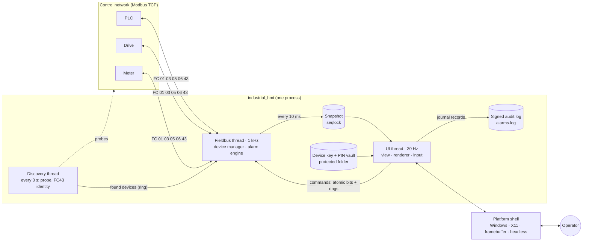
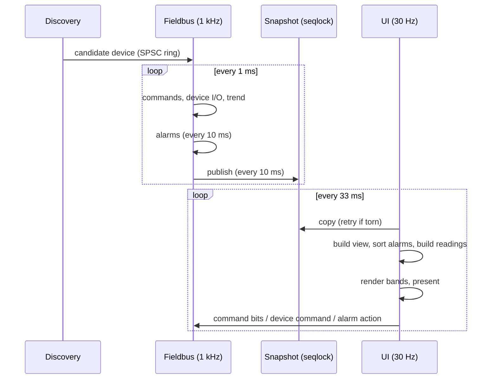
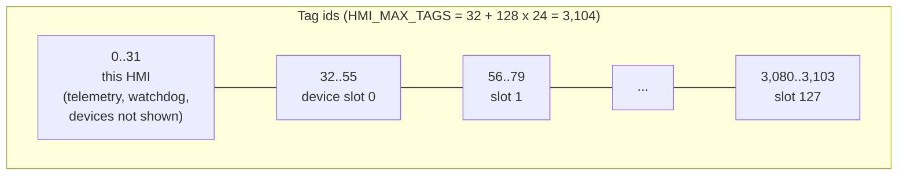
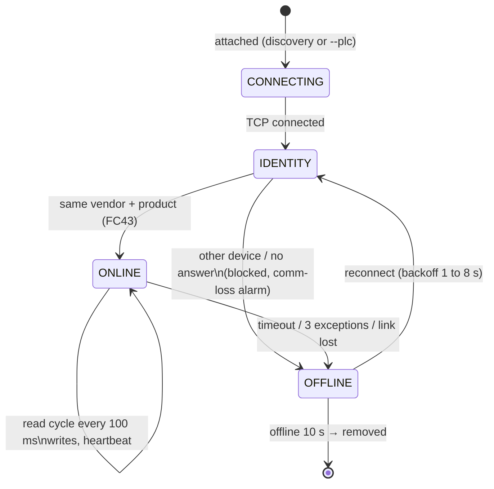
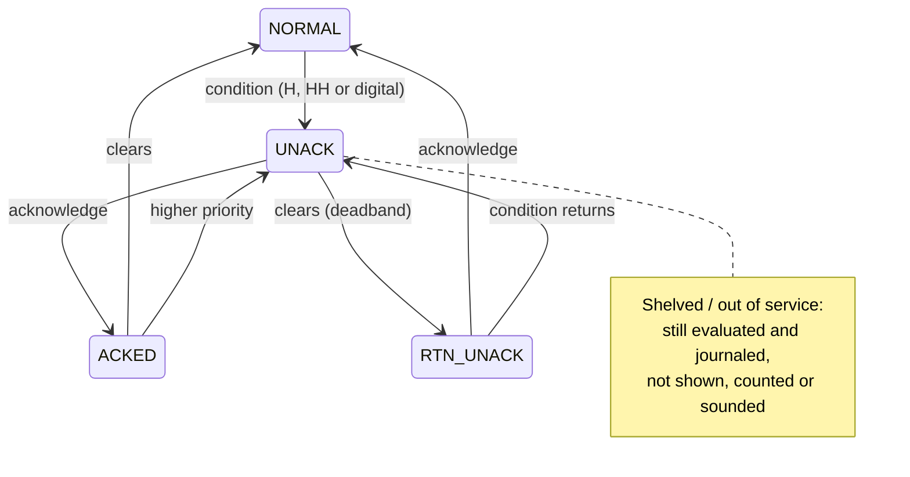
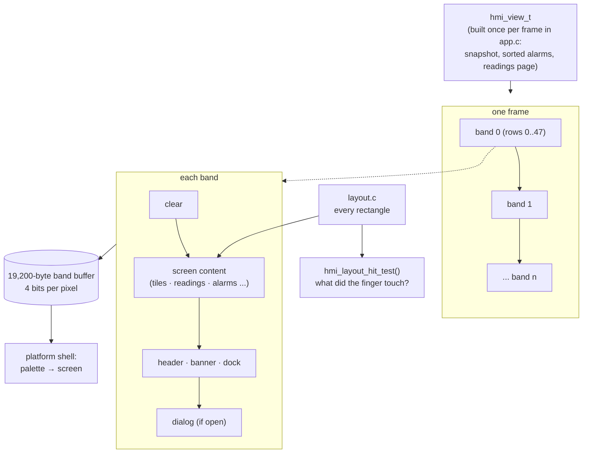
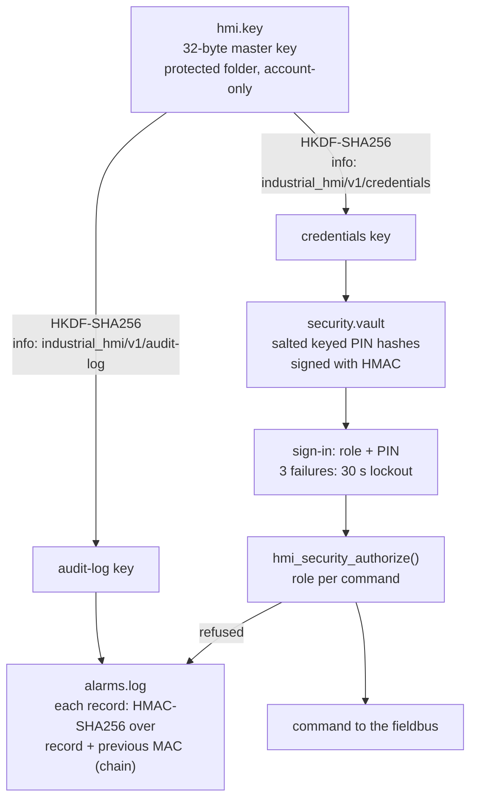

# Architecture

How the Prometheus HMI runtime is built: the whole system first, then each custom part.
File names are relative to `hmi-runtime/`. For a guided tour of the source, see
[Where the code starts](../code/ENTRY-POINTS.md).

---

## 1. The whole runtime

| Layer | Folder | Rule |
|---|---|---|
| Application | `src/app/` | portable C99, no operating-system headers |
| Core | `src/core/` | tags, alarms, audit log, security, keys, crypto; no OS headers, no heap |
| Devices | `src/devices/` | one module per device type, constant data only |
| Fieldbus | `src/fieldbus/` | Modbus codec, device manager, discovery; sockets through the HAL |
| Renderer | `src/renderer/` | drawing and geometry; no OS headers |
| HAL | `src/hal/` | the only code that calls the operating system: network, files, threads, timers, sound |
| Platform shells | `src/platform/` | `main`, the window or framebuffer, input |

Nothing in the runtime allocates memory from the heap. Every table is sized at build time from
`include/config.h`.

## 2. Threads and the hand-off

- **No locks between the threads.** The fieldbus thread is the only writer of the shared
  snapshot. It increments a sequence number before and after writing. The UI copies the snapshot
  and checks the number did not change, else it copies again (`include/core/seqlock.h`).
- **Commands flow the other way** as atomic bits (acknowledge all, silence, stop latch reset,
  EMERGENCY reset), a per-alarm acknowledge bitmask, and single-producer single-consumer rings for
  device commands, alarm actions and audit events.
- **Each side watches the other.** The fieldbus thread checks the UI heartbeat, and the UI checks
  the fieldbus heartbeat (`src/core/watchdog.c`). If the UI stalls, the fieldbus thread raises
  "HMI watchdog failover" and stops sending the HMI heartbeat to the PLCs.

## 3. Tag table

Every value is a **tag**: a 16-bit id, a 16-bit value, a quality and its metadata.

- **Address of a reading:** `HMI_DEV_TAG(slot, rel)` = 32 + slot x 24 + rel. `rel` is the
  reading's number inside its driver module (0 to 23).
- **Values** (`hmi_tag_table_t`, `include/core/tags.h`): value, quality (good, bad, comm fault,
  simulated) and decimals, plus a 60-second trend per device.
- **Metadata** (`hmi_tag_meta_t`): name, unit, range, warning and trip limits, digital alarm
  priority, and two lines of operator guidance. It is registered when a device is attached and
  read without locks afterwards.
- **Capacity:** `HMI_MAX_DEVICES` (128) sets everything at build time. It can be at most 250,
  because slot numbers are 8-bit. `--max-devices` lowers the limit at run time without a rebuild.

## 4. Fieldbus: device manager and discovery

Files: `src/fieldbus/device_manager.c`, `discovery.c`, `modbus_proto.c`.

- **Discovery** probes every configured address in batches of 32 non-blocking sockets, asks for
  the FC43 identity, and hands identified PLCs and drives to the fieldbus thread. Meters and other
  devices attach only when listed with `--plc`.
- **The identity check runs after every connect.** Before anything is read or written, the
  device must give the vendor and product it gave when attached. If it does not, the link is
  dropped, the comm-loss alarm is raised and the journal says "other device answers, blocked".
- **The read plan** comes from the driver module: register and coil blocks, each read in turn.
  A cycle that completes stamps `data_us`, the start of the latency measurement.
- **Writes** go through a queue of 8 per device. Reset buttons are pulses, and their release is
  never dropped. The heartbeat has its own slot and is sent only while the UI is alive and there
  is no EMERGENCY.
- **STOP ALL / EMERGENCY** (`hmi_devmgr_stop_all`) cancels queued writes, then writes each
  device's stop latch or every stop control. Any device it could not stop is reported as NOT
  stopped: offline, no stop control, or on the network but not attached.

## 5. Alarm engine

File: `src/core/alarms.c`. Runs every 10 ms on the fieldbus thread.

1. **Per point:** skip it while its data is bad; work out the condition with a deadband; move
   the state machine; journal every change.
2. **Shelving:** a shelved point returns when its time is up. A chatter flag clears after a quiet
   window.
3. **Rate:** new alarms are counted in ten one-minute buckets. A flood starts above 10 in
   10 minutes and ends below 5.
4. **Summary:** shown counts, horn (Info alarms are silent during a flood), and the guidance for
   the highest-priority shown alarm.

The **journal** is a 512-record ring. The UI thread copies new records into the signed audit log
once a frame (`src/core/alarm_log.c`). If the ring ever overran, a "RECORDS LOST" record would
say so. Details: [Alarm management](../design/ALARMS.md).

## 6. Renderer

Files: `src/renderer/micro_renderer.c`, `layout.c`, `font_inter.c`.

- **Bands, not frames.** The screen is drawn in horizontal bands into one 19,200-byte buffer
  (4 bits per pixel), and each band is handed to the display before the next one is drawn. RAM
  stays the same at any screen size: 48 rows per band at 800 px wide, 20 rows at 1,920.
- **16 colours, smooth edges.** A 16-entry palette per theme. A 16 x 16 x 4 lookup table blends
  anti-aliased text and curves through real intermediate tones, with no floating point.
- **One geometry.** `layout.c` returns every rectangle. The renderer draws there, and the hit
  test answers from the same rectangles, so drawing and touch cannot disagree.
- **Work once per frame.** Sorting alarms, building the Readings list and the latency probe
  happen once per frame in `app.c`, not once per band.

Why a custom renderer and not LVGL: [ADR-0001](../adr/0001-custom-band-renderer.md) and the
[benchmarks](../benchmarks/README.md).

## 7. Security

Files: `src/core/device_key.c`, `security.c`, `alarm_log.c`, `sha256.c`.

- **One master key per panel**, created on first start from the OS random source. It is kept in
  `%ProgramData%\Prometheus HMI` (Windows, protected DACL) or `/var/lib/prometheus-hmi` (Linux,
  mode 0700). The master key itself is wiped from memory after the purpose keys are derived.
- **Audit log:** every record carries an HMAC over itself and the previous record's MAC. Editing,
  reordering or removing a record breaks the chain, and `--verify-log` reports where. One known
  gap: records cut off the end of the newest file cannot be detected.
- **PINs:** 6 to 8 digits, with no repeated or sequential patterns. They are stored as salted,
  keyed hashes (2,000 HMAC rounds) in a signed vault. They are never accepted on the command line.
- **Roles:** a table of the minimum role for each command (`s_required_role`). EMERGENCY is the
  one command no role, dialog or lock can block.

Policy and risks: [Security policy](../SECURITY.md), [Threat model](../THREAT-MODEL.md).
